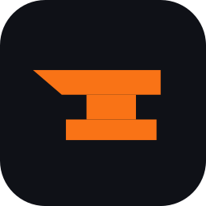

<p align="center"></p>

<h1 align="center">DevForge</h1>

<p align="center"><strong>Your whole Windows dev workshop in one app: projects, Git, Docker, servers, databases and deployments.</strong><br />Free, open source, no account. Your secrets stay on your PC.</p>

<p align="center">
  <a href="https://victhille.github.io/devforge/en/download/"><strong>Download for Windows</strong></a> ·
  <a href="https://victhille.github.io/devforge/en/">Website and docs</a> ·
  <a href="README.md">Français</a>
</p>

<p align="center">

[](https://github.com/victhille/devforge/releases/latest)
[](https://github.com/victhille/devforge/actions/workflows/ci.yml)
[](LICENSE)


</p>


A Windows desktop app (Electron + React) that brings everyday dev tools together in one place: projects, Git, Docker / Compose, SSH and servers, databases, deployments, monitoring, `.env`, local domains, a toolbox, and Forgy, an AI assistant.

DevForge ships with nothing personal: on first launch you pick your language and projects folder, then connect your own accounts (GitHub, servers, Vercel, databases, Anthropic key). Everything stays on your PC, with secrets encrypted by Windows.

## What it does

- **Projects**: guided creation (Laravel, Symfony, Next.js, Node…), open in your editor, built-in terminal, scripts, per-framework workshops.
- **Git and GitHub**: status, branches, commits, pull requests.
- **Docker**: containers, Compose, a Docker database per project, a server's Docker over SSH.
- **Servers**: SSH connections, health, services, backups, VPN, n8n, status page.
- **Databases**: connections, queries, backups, modeling (conceptual and physical models, diagrams) and an API tester.
- **Deployments**: Vercel and servers.
- **Forgy** (Ctrl+J): an assistant using your own Anthropic key, read-only tools, controlled cost. See [docs/guide/forgy.md](docs/guide/forgy.md).

## Install

Download the `DevForge-Setup-vx.y.z.exe` installer from the [Download page](https://victhille.github.io/devforge/en/download/) or the [releases](https://github.com/victhille/devforge/releases). DevForge then updates itself. [Getting started](https://victhille.github.io/devforge/en/getting-started/installation/) covers the install and every page of the app.

The installer is not signed yet: Windows SmartScreen may say "Windows protected your PC". Click "More info", then "Run anyway". Its SHA-256 checksum is on the Download page and in each version's notes, to [check the file](https://victhille.github.io/devforge/en/download/#check-the-installer).

## Set up

Everything is in **Settings › Connections**: GitHub (GitHub CLI or token), Git identity, Forgy key, Vercel, Docker, SSH servers, databases. Each service is tested and removed from the same place. **Settings › Data** exports your setup (without secrets), imports it on another PC, or erases everything.

## Develop

You need Node.js 22 and Windows.

```bash
npm install
npm run dev        # app with hot reload
npm run check      # types + lint + tests + build (same as CI)
npm test           # tests only (Vitest); npm run test:watch to keep running
npm run test:e2e   # end-to-end tests (Playwright, on the built app)
npm run dist       # Windows installer in dist/
```

For a fork: change `repository` and `build.publish` in `package.json`; updates and the "About" links follow.

SemVer versions, conventional commits, `npm run release` to publish: see [docs/dev/versions.md](docs/dev/versions.md). To contribute: [CONTRIBUTING.md](CONTRIBUTING.md).

## License

[GPL-3.0](LICENSE) since v4.0: you may read, change and redistribute DevForge, as long as any modified version stays free, under the GPL-3.0, with its source code. Versions up to 3.9 remain under MIT.

The "DevForge" name, the logo and Forgy are not under this license: a fork takes another name, see [TRADEMARKS.md](TRADEMARKS.md). Contributions go through a [contributor agreement](CLA.md).
