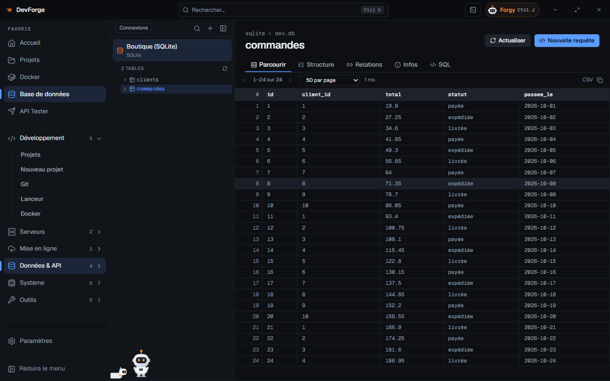

La page **Base de données** est un client pour **PostgreSQL**, **MySQL / MariaDB** et **SQLite**. Les mots de passe sont chiffrés par Windows.

## Ajouter une connexion

**+** ouvre le formulaire :

| Champ | Détail |
|---|---|
| Type | PostgreSQL, MySQL / MariaDB ou SQLite |
| Nom | facultatif, par défaut `base@hôte` |
| Hôte, port, utilisateur, mot de passe, base | pour PostgreSQL et MySQL |
| Fichier SQLite | pour SQLite |
| Se connecter via | **Connexion directe**, ou un serveur SSH : la connexion passe alors par un **tunnel SSH**, rien à ouvrir sur le serveur. L'hôte et le port sont ceux vus depuis le serveur (`127.0.0.1` pour un service local) |

**Tester la connexion** vérifie avant d'enregistrer.

## Détecter des bases

**Détecter des bases** cherche des bases à ajouter sans rien saisir :

- **Sur un serveur (SSH)** : les conteneurs Docker PostgreSQL / MySQL / MariaDB (identifiants lus dans leur configuration) et les services installés sur le serveur. Ces bases passent par un tunnel SSH.
- **Dans vos projets (.env)** : les bases décrites dans les fichiers `.env` de tes projets.

**Ajouter** enregistre une base trouvée. Le bouton *Bases de données du serveur* de la page [SSH](/devforge/servers/ssh/) ouvre directement cette détection.

## Explorer

Choisis une connexion : la liste des tables (filtrable) s'affiche. L'onglet **Base** résume le serveur, la base, le nombre de tables, de vues et de lignes (estimation), les index et clés étrangères.

Pour une table :

| Onglet | Contenu |
|---|---|
| Parcourir | les lignes, page par page, triables en cliquant sur une colonne |
| Structure | colonnes (type, null, défaut, clé, extra, commentaire) et index ; ajouter, modifier ou supprimer une colonne, renommer ou supprimer la table (voir plus bas) |
| Relations | clés étrangères vers d'autres tables, et tables qui pointent vers celle-ci |
| SQL | une requête sur cette table |
| Infos | lignes, taille (données et index), moteur, interclassement, encodage, définition (DDL) |

## Créer et modifier des tables

- **Nouvelle table** (le **+** en haut de la liste des tables) : son nom et ses colonnes. Une colonne `id` auto-incrémentée est prête ; chaque colonne a un **type** (proposés selon la base, ou à taper : `VARCHAR(255)`, `NUMERIC(10, 2)`…), un **défaut**, et les cases **Requis**, **Clé primaire**, **Auto-incrément**.
- Dans **Structure** : **Ajouter une colonne**, le crayon d'une colonne pour la modifier (nom, type, défaut, requis), la corbeille pour la supprimer ; **Renommer la table** ; **Supprimer la table**, qui demande de retaper son nom.

Chaque fenêtre montre d'abord la **requête qui va partir** ; rien ne s'exécute avant **Appliquer**. En cas d'erreur de la base, son message reste affiché et rien d'autre ne part.

Un défaut est pris tel quel s'il s'agit d'un nombre, d'un mot-clé (`CURRENT_TIMESTAMP`, `NULL`, `TRUE`…), d'une fonction (`now()`) ou d'une chaîne déjà entre apostrophes ; sinon il est mis entre apostrophes.

**SQLite** ne sait que renommer une colonne : pour changer son type, son défaut ou « Requis », la fenêtre renvoie à l'onglet **SQL**.

## Requêtes SQL

**Nouvelle requête** ouvre un éditeur SQL. <kbd>Ctrl</kbd> <kbd>Entrée</kbd> exécute. Les résultats sont limités à 1000 lignes ; une requête d'écriture affiche le nombre de lignes modifiées. Au-dessus des résultats, **CSV** ou **JSON** choisit le format de la copie (le choix est gardé) : en JSON, un objet par ligne.

## Ailleurs

- Une base peut être liée à un projet : l'onglet **Base de données** de sa [fiche](/devforge/dev/projects/#la-base-de-données-du-projet) l'explore sur place. **Ouvrir en grand** mène ici, et **← Retour à** *nom du projet* y ramène.
- [Nouveau projet](/devforge/dev/new-project/) ajoute ici la base qu'il crée.
- Forgy lit la structure des tables (jamais les données) quand cette page est ouverte, écrit du SQL et peut exécuter une requête après ton accord, avec des garde-fous (voir [Actions](/devforge/forgy/actions/#garde-fous)).
