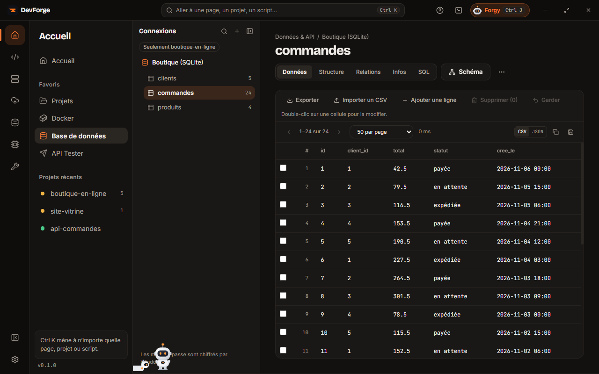

La page **Base de données** est un client pour **PostgreSQL**, **MySQL / MariaDB** et **SQLite**. Les mots de passe sont chiffrés par Windows.

## Ajouter une connexion

**+** ouvre le formulaire :

| Champ | Détail |
|---|---|
| Type | PostgreSQL, MySQL / MariaDB ou SQLite |
| Nom | facultatif, par défaut `base@hôte` |
| Hôte, port, utilisateur, mot de passe, base | pour PostgreSQL et MySQL |
| Fichier SQLite | pour SQLite, un fichier sur ce PC : un fichier sur un partage réseau est refusé, car Windows y enverrait ton identifiant |
| Se connecter via | **Connexion directe**, ou un serveur SSH : la connexion passe alors par un **tunnel SSH**, rien à ouvrir sur le serveur. L'hôte et le port sont ceux vus depuis le serveur (`127.0.0.1` pour un service local) |

**Tester la connexion** vérifie avant d'enregistrer.

En modification, un mot de passe laissé vide garde celui enregistré, tant que la base reste au même endroit. Si son type, son hôte, son port, son utilisateur ou son serveur SSH change, le mot de passe est oublié et le formulaire demande de le saisir à nouveau : il ne part jamais vers une autre machine.

## Détecter des bases

**Détecter des bases** cherche des bases à ajouter sans rien saisir :

- **Sur un serveur (SSH)** : les conteneurs Docker PostgreSQL / MySQL / MariaDB (identifiants lus dans leur configuration) et les services installés sur le serveur. Ces bases passent par un tunnel SSH. Un conteneur n'est retenu que si le serveur peut le joindre : un port publié, ou une adresse de son réseau privé.
- **Dans vos projets (.env)** : les bases décrites dans les fichiers `.env` de tes projets. Une base dont l'hôte est celui d'un de tes serveurs passe par lui. Si plusieurs serveurs y sont enregistrés sur des ports différents, DevForge ne devine pas : choisis le bon dans **Se connecter via**.

**Ajouter** enregistre une base trouvée. Le bouton *Bases de données du serveur* de la page [SSH](/devforge/servers/ssh/) ouvre directement cette détection.

## Explorer

Le panneau **Connexions**, à gauche, liste tes bases. Choisis-en une : ses tables (filtrables) se déplient dessous, avec le nombre de lignes de chacune (une estimation sur PostgreSQL et MySQL). En bas du panneau, un rappel : les mots de passe sont chiffrés par Windows. Au-dessus du titre, « Données & API / nom de la connexion » ramène à la vue d'ensemble de la base. Les onglets sont en haut à droite, à côté de **Schéma** et du menu **⋯** (**Actualiser**, **Rechercher dans la base**, **Nouvelle table**, **Nouvelle requête**). L'onglet **Base** résume le serveur, la base, le nombre de tables, de vues et de lignes (estimation), les index et clés étrangères.

Pour une table :

| Onglet | Contenu |
|---|---|
| Données | les lignes, page par page, triables en cliquant sur une colonne ; modifiables (voir plus bas), exportables, et un CSV s'y importe |
| Structure | colonnes (type, null, défaut, clé, extra, commentaire) et index ; ajouter, modifier ou supprimer une colonne, renommer ou supprimer la table (voir plus bas) |
| Relations | clés étrangères vers d'autres tables, et tables qui pointent vers celle-ci |
| SQL | une requête sur cette table |
| Infos | lignes, taille (données et index), moteur, interclassement, encodage, définition (DDL) |

## Rechercher dans la base

L'onglet **Rechercher** (ou **Rechercher dans la base** dans le menu **⋯**) cherche une valeur dans **toutes les tables à la fois**, comme la recherche de phpMyAdmin, en plus simple :

- Tape ce que tu cherches puis <kbd>Entrée</kbd>. Chaque colonne est lue comme du texte : nombres, dates et JSON compris.
- Le **mode** : **Contient le texte** (par défaut), **Au moins un des mots**, **Tous les mots** (chaque mot quelque part dans la ligne), **Valeur exacte** ou **Expression régulière**. Pour les mots, des guillemets gardent une expression entière : `"rue de Paris"`.
- **Respecter la casse** : sans cette case, majuscules et minuscules sont confondues, lettres accentuées comprises (`élodie` trouve `Élodie`).
- **Dans la colonne** limite la recherche aux colonnes de ce nom (proposées d'après les tables) ; seules les tables qui l'ont sont fouillées.
- **Tables** : toutes par défaut, les vues à part ; déplie la liste pour en cocher certaines.

Les tables sont fouillées une à une, et chacune s'affiche dès qu'elle a répondu ; **Arrêter** interrompt la recherche. Pour chaque table qui contient le terme : le nombre de lignes trouvées, les colonnes où il est, et les 50 premières lignes, la clé et ces colonnes en premier, le terme surligné. **Voir le SQL** met dans l'onglet **SQL** la requête qui ramène toutes les lignes ; **Ouvrir la table** affiche ses données. Les résultats restent là quand tu reviens sur l'onglet.

La recherche ne fait que lire, et le terme part en paramètre, jamais collé dans le SQL. Chaque table fouillée est lue en entier : sur une grosse base, limite-toi à une colonne ou à quelques tables. Les expressions régulières suivent la syntaxe de la base : POSIX pour PostgreSQL, ICU ou PCRE pour MySQL / MariaDB, JavaScript pour SQLite.

## Le schéma

**Schéma** (en haut à droite) ouvre la base en plein écran : chaque table en carte, avec ses colonnes, leur type, la clé primaire 🔑 et les colonnes requises (`!`). Une flèche par clé étrangère va de la colonne qui pointe vers la colonne pointée.

- **Placement automatique** : les tables pointées à gauche, celles qui pointent vers elles à droite, rangées pour que les flèches se croisent peu. Les tables sans lien vont en dessous.
- **Déplacer** une table : glisse-la par son titre. Les positions sont gardées pour chaque base ; **Réorganiser** revient au placement automatique.
- **Naviguer** : glisse le fond pour te déplacer, la molette zoome, **Ajuster** montre tout. La **mini-carte** en bas à droite montre la partie à l'écran ; un clic dessus y va.
- **Les tables montrées** : la liste à gauche les coche et les cherche ; **+ voisines** ajoute celles qui sont liées aux tables cochées. Au-delà de 60 tables, aucune n'est montrée au départ : coche celles qui t'intéressent.
- Un clic sur le titre d'une table ouvre sa **Structure**.
- **PNG** ou **SVG** enregistre le schéma en image, aux couleurs du thème.

PostgreSQL (tous les schémas), MySQL / MariaDB et SQLite.

## Créer et modifier des tables

- **Nouvelle table** (dans le menu **⋯**, ou le **+** des tables dans l'onglet d'un projet) : son nom et ses colonnes. Une colonne `id` auto-incrémentée est prête ; chaque colonne a un **type** (proposés selon la base, ou à taper : `VARCHAR(255)`, `NUMERIC(10, 2)`…), un **défaut**, et les cases **Requis**, **Clé primaire**, **Auto-incrément**.
- Dans **Structure** : **Ajouter une colonne**, le crayon d'une colonne pour la modifier (nom, type, défaut, requis), la corbeille pour la supprimer ; **Renommer la table** ; **Supprimer la table**, qui demande de retaper son nom.

Chaque fenêtre montre d'abord la **requête qui va partir** ; rien ne s'exécute avant **Appliquer**. En cas d'erreur de la base, son message reste affiché et rien d'autre ne part.

Un défaut est pris tel quel s'il s'agit d'un nombre, d'un mot-clé (`CURRENT_TIMESTAMP`, `NULL`, `TRUE`…), d'une fonction (`now()`) ou d'une chaîne déjà entre apostrophes ; sinon il est mis entre apostrophes.

**SQLite** ne sait que renommer une colonne : pour changer son type, son défaut ou « Requis », la fenêtre renvoie à l'onglet **SQL**.

## Modifier les lignes

Dans **Données**, une table qui a une **clé primaire** se modifie sur place :

- **double-clic** (ou <kbd>Entrée</kbd>) sur une cellule pour la modifier ; **NULL** d'un clic à côté du champ ; <kbd>Échap</kbd> annule ;
- **Ajouter une ligne** : une ligne vide en haut ; une cellule laissée vide garde la valeur par défaut de la colonne (l'auto-incrément, par exemple) ;
- coche des lignes, puis **Supprimer** : elles sont barrées ; **Garder** les reprend.

Les changements en attente sont surlignés ; tant qu'il y en a, la page et le tri ne changent pas. **Appliquer (n modifications)** montre les requêtes `UPDATE`, `INSERT` et `DELETE`, puis les lance **en une transaction** : si l'une échoue, aucune n'est gardée et le message de la base reste affiché. **Annuler les modifications** les oublie.

Les valeurs partent en paramètres, jamais collées dans le SQL. Une table sans clé primaire, une vue et les résultats de l'onglet SQL restent en lecture ; les colonnes binaires ne se modifient pas ici.

## Importer et exporter

- **Exporter** (dans **Données**) écrit **toute la table** dans un fichier, pas seulement la page affichée : **CSV**, **JSON**, **SQL** (des `INSERT`) ou **SQL avec CREATE TABLE**. Les lignes sont lues par paquets de 1 000, dans l'ordre de la clé primaire.
- Les résultats d'une requête s'enregistrent aussi, en CSV ou en JSON, avec le bouton à côté de **Copier**.
- **Importer un CSV** : choisis le fichier ; le séparateur (`,`, `;`, tabulation, `|`) et l'encodage (UTF-8, ou Windows-1252 comme les CSV d'Excel) sont reconnus. Chaque colonne du fichier va dans la colonne de la table du même nom (casse, espaces, `_` et `-` ignorés) ; sous chaque en-tête, tu la changes ou tu l'ignores. Les 10 premières lignes s'affichent ; **Une cellule vide devient NULL** est coché par défaut.
- L'import part **en une transaction** : si une ligne est refusée (colonne requise vide, doublon de clé…), aucune n'est gardée et la ligne fautive du fichier est donnée. 50 Mo au plus.

Les fichiers passent toujours par la fenêtre d'enregistrement ou d'ouverture de Windows.

## Requêtes SQL

L'onglet **SQL** (ou **Nouvelle requête** dans le menu **⋯**) ouvre un éditeur SQL. **Exécuter** ou <kbd>Ctrl</kbd> <kbd>Entrée</kbd> lance la requête ; **Écrire avec Forgy** lui demande de l'écrire ou de la corriger d'après la structure de la base. Les résultats sont limités à 1000 lignes ; une requête d'écriture affiche le nombre de lignes modifiées. Au-dessus des résultats, **CSV** ou **JSON** choisit le format de la copie (le choix est gardé) : en JSON, un objet par ligne.

## Ailleurs

- Une base peut être liée à un projet : l'onglet **Base de données** de sa [fiche](/devforge/dev/projects/#la-base-de-données-du-projet) l'explore sur place. **Ouvrir en grand** mène ici, et **← Retour à** *nom du projet* y ramène.
- [Nouveau projet](/devforge/dev/new-project/) ajoute ici la base qu'il crée.
- Forgy lit la structure des tables (jamais les données) quand cette page est ouverte, écrit du SQL et peut exécuter une requête après ton accord, avec des garde-fous (voir [Actions](/devforge/forgy/actions/#garde-fous)).
