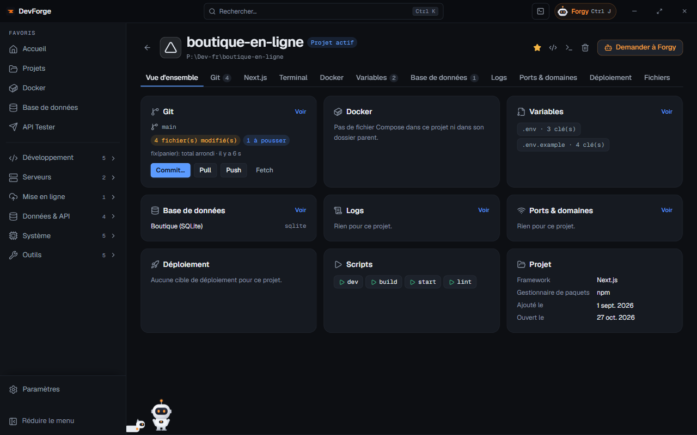

## La liste des projets

La page **Projets** montre :

- **Vos projets** : ceux que DevForge suit. Chaque carte affiche le framework, l'état Git (« modifs en cours ») et des boutons **Ouvrir**, le nom de l'[IDE](/devforge/dev/ide/) du projet (aucun bouton si l'IDE choisi est « Aucun »), **Terminal**, **Scripts** (les scripts du `package.json`), **Favori** et **Retirer**.
- **Détectés dans…** : les projets trouvés dans tes dossiers de projets mais pas encore suivis. **Importer** les ajoute.

Filtre par nom, et par framework : seuls les frameworks de tes projets ont un filtre, et aucun filtre ne s'affiche s'il n'y en a qu'un. **Rescanner** relit les dossiers. Au bout de la ligne des filtres, **Ajouter un dossier** mène aux dossiers de projets des [Paramètres](/devforge/settings/general/), pour des projets rangés ailleurs.

**Retirer** un projet l'enlève de DevForge ; le dossier n'est jamais supprimé.

## Plusieurs dossiers de projets

Tes projets peuvent vivre dans plusieurs dossiers (« Projet Perso », « Projet Cefim »…). Dans [Paramètres › Général](/devforge/settings/general/), **Dossiers de projets** en tient la liste :

- **Ajouter un dossier**, **Retirer ce dossier** (rien n'est supprimé sur le disque), **Monter** / **Descendre** pour les réordonner ;
- le **premier** est le dossier *par défaut* : le terminal intégré s'y ouvre et les nouveaux projets y vont d'office.

Avec plusieurs dossiers, la page Projets les parcourt tous : chaque carte porte le nom de son dossier, discret, et une ligne de filtres par dossier s'ajoute (**Tous les dossiers**, puis un par dossier). Un dossier qui n'existe plus est signalé (« Dossier introuvable ») au lieu de faire une erreur.

Dans [Nouveau projet](/devforge/dev/new-project/), la destination propose tes dossiers en un clic.

## Les projets imbriqués (groupes)

Un dossier qui n'est pas un projet mais en contient plusieurs, par exemple `FreelanceManager/` avec `backend/` (Symfony) et `frontend/` (React), devient un **groupe** :

- DevForge y descend d'un niveau, deux au plus, quand le dossier n'a pas de fichier de projet (`package.json`, `composer.json`, `pyproject.toml`, `Cargo.toml`, `go.mod`…) mais que ses sous-dossiers en ont. `node_modules`, `vendor`, les dossiers de build et les dossiers cachés sont ignorés.
- La **carte du groupe** porte « groupe · *n* projets » et les technos de ses projets. Dépliée, elle montre chaque sous-projet avec sa techno, son état Git, son IDE, son terminal et ses scripts ; **Replier le groupe** la réduit à une ligne (le choix est retenu). En bas : le groupe entier dans l'IDE, son terminal, **Ouvrir la fiche**. Dépliée, elle prend deux colonnes et les cartes suivantes remontent dans la place libre.
- Ce qui n'est pas un projet fait aussi partie du groupe : sous ses projets, la carte liste « Aussi dans le dossier : » `docs/`, `infra/`, `README.md`, `Dockerfile`… (repliée : « + *n* autres »). Les dossiers cachés et de dépendances n'y sont pas.
- Le filtre **Groupes** ne garde qu'eux ; un filtre de framework retient aussi un groupe dont un projet l'utilise.
- Un projet que tu suivais déjà et qui fait partie d'un groupe suivi n'apparaît plus deux fois : il est dans son groupe.

La **fiche d'un groupe** commence par ses projets côte à côte. Chacun a son IDE, son terminal et ses onglets : **Scripts**, son **atelier** (Symfony, Next.js, Laravel), **Variables**, **Fichiers**. **Tout lancer** démarre le script `dev` (ou `start`) de chacun. Le reste de la fiche (Git, Docker, base, logs…) porte sur le dossier du groupe.

Les bases de données sont cherchées dans le `.env` et le `compose.yaml` de **chaque** projet du groupe : la base du back apparaît dans la page [Base de données](/devforge/data/database/) sous le nom *groupe/back*, et sur la fiche du groupe.

## La fiche d'un projet

Clique sur un projet pour ouvrir sa fiche. En haut : le nom, le chemin (cliquer ouvre le dossier), et les boutons **Favori**, **Ouvrir dans l'IDE**, **Ouvrir un terminal**, **Retirer de DevForge** et **Demander à Forgy** (Forgy s'ouvre avec ce projet en contexte). Ouvrir une fiche rend le projet **actif**.

La tuile **Projet** de la vue d'ensemble a un choix **IDE de ce projet** : *Par défaut* suit les Paramètres, ou un autre IDE trouvé sur ce PC, que ce projet gardera (voir [IDE](/devforge/dev/ide/)).

Les onglets n'apparaissent que s'ils ont un sens pour ce projet :

| Onglet | Contenu |
|---|---|
| Vue d'ensemble | une tuile par sujet (Git, Docker, variables, base, ports…) avec son résumé et **Voir** |
| Git | branche, fichiers modifiés, commits à pousser ou à récupérer, dernier commit, **Commit…**, **Pull**, **Push**, **Fetch** |
| GitHub | si le dépôt est sur GitHub : GitHub Actions (avec **Relancer les échecs**), pull requests ouvertes, versions publiées |
| Atelier Symfony / Next.js / Laravel | selon le framework, voir plus bas |
| Terminal | un terminal intégré ouvert dans le dossier du projet |
| Docker | le projet Compose du dossier (ou du dossier parent) : services, état, démarrer / arrêter |
| Variables | les fichiers `.env` et leurs clés, voir [Variables .env](/devforge/system/env-files/) |
| Paquets | si le projet a un `package.json`, un `composer.json` ou les dépendances d'un autre langage (Python, Rust, Go…) : versions, vulnérabilités, mises à jour ; voir [Paquets](/devforge/dev/packages/) |
| Base de données | la base liée, explorée sur place (voir plus bas) ; **Lier une connexion…** |
| Logs | les fichiers de log trouvés (`storage/logs`, `var/log`, `logs`…), suivis en direct ; on peut en ajouter un par son chemin |
| Ports & domaines | les ports trouvés dans la config (`.env`, scripts, Compose), en écoute ou libres, **Libérer** ; les domaines locaux liés |
| Déploiement | les cibles de déploiement du projet et **Synchroniser le .env** avec le serveur |
| Vercel | si le dossier est lié à Vercel : déploiements, variables, domaines |
| Fichiers | l'arborescence du projet, avec l'aperçu du fichier cliqué (les scripts sont dans la vue d'ensemble) |

Ce que DevForge a **trouvé** seul (une base, un domaine, un port) est marqué *trouvé* ; ce que tu as lié à la main, *ajouté*. **Retirer du projet** masque un élément ; **Réafficher** le remet.

### L'aperçu des fichiers

Dans l'onglet **Fichiers**, un clic sur un fichier l'ouvre à côté de l'arbre :

| Fichier | Aperçu |
|---|---|
| Markdown (`.md`) | mis en forme : titres, listes, tableaux, code ; **Voir le source** montre le texte brut |
| Images (`.png`, `.jpg`, `.svg`, `.webp`…) | l'image, sur un damier pour la transparence |
| PDF | les pages dessinées (les 20 premières, puis **Afficher les pages suivantes**) |
| Texte et code (`Dockerfile`, `.env`, `.ts`, `.vue`, `.py`, `.yaml`…) | en couleurs comme dans un IDE (le langage reconnu à l'extension), avec **Copier le contenu** |

**Ouvrir dans** *ton IDE* (à côté de **Copier**) ouvre le fichier dans l'[IDE](/devforge/dev/ide/) du projet. Avec VS Code, Cursor, Windsurf, Antigravity et Zed, il s'ouvre dans la fenêtre de ce projet (ouverte au besoin), même si l'IDE était sur un autre projet.

Un fichier binaire (archive, exécutable, document Office) ou trop gros (plus de 1 Mo de texte, 10 Mo d'image, 30 Mo de PDF) le dit au lieu de s'afficher. Rien n'est lancé : le fichier est seulement lu.

### La base de données du projet

L'onglet **Base de données** affiche directement la base liée : les tables dans une colonne repliable, puis les mêmes onglets que la page [Base de données](/devforge/data/database/#explorer) (**Base** et **SQL**, et pour une table **Parcourir**, **Structure**, **Relations**, **Infos**). La connexion ne s'ouvre qu'à l'affichage de l'onglet.

- Plusieurs bases liées : la première est affichée, **Afficher** sur une autre ligne en change.
- **Ouvrir en grand** ouvre la page Base de données ; son bouton **← Retour à** *nom du projet* ramène sur cet onglet.

### Synchroniser le .env avec le serveur

Depuis l'onglet **Déploiement**, **Synchroniser le .env** compare le fichier sur ce PC et celui du serveur. Seul l'état de chaque clé s'affiche (*identique*, *différente*, *seulement ici*, *seulement sur le serveur*) : **les valeurs ne sont jamais montrées**.

- **Envoyer vers le serveur** : les clés d'ici remplacent celles du serveur. Une copie du fichier du serveur est gardée à côté (`.devforge-….bak`).
- **Récupérer ici** : l'inverse. Une copie chiffrée des `.env` du projet est faite avant (restaurable depuis [Variables .env](/devforge/system/env-files/)).

## Les ateliers par framework

Les projets **Symfony**, **Next.js** et **Laravel** ont un onglet *Atelier* qui fait le travail courant sans écrire de commande. Il est organisé en parties :

| Partie | Ce qu'elle fait |
|---|---|
| Base de données | la base utilisée (`DATABASE_URL` ou `DB_*`), son état, **Démarrer la base (Docker)**, **Créer la base**, ou utiliser une connexion de la page Base de données (écrite dans `.env.local`, qui ne se commite pas) |
| Entités / Modèles | un schéma visuel et un formulaire : un nom, des champs (texte court ou long, nombre entier ou à virgule, décimal, oui / non, date, date et heure, liste JSON), des liens (*appartient à*, *a plusieurs*, *est lié à plusieurs*, *a un seul*). DevForge écrit les fichiers ; rien ne touche la base avant la migration |
| Migrations | préparer une migration, voir son SQL, **Appliquer** ou **Revenir en arrière** ; alerte si elle supprime des données ; **Expliquer avec Forgy** |
| API | ce que chaque entité expose (lister, voir, créer, modifier, supprimer), avec **Tester** dans l'API Tester |
| Utilisateurs et connexion | Symfony : entité User et page de connexion ; Next.js : Auth.js avec GitHub, Google ou e-mail et mot de passe |
| Fausses données | générer des données réalistes (Faker) pour essayer l'appli ; efface les données actuelles |
| Routes | toutes les adresses de l'appli, filtrables, à ouvrir dans le navigateur ou l'API Tester |
| Serveur | démarrer le serveur local, ouvrir le site, vider le cache, installer les dépendances |

Spécificités :

- **Symfony** : API Platform (routes générées, documentation sur `/api/docs`) ou contrôleurs JSON écrits par DevForge ; pages CRUD avec MakerBundle ; serveur de Symfony CLI.
- **Next.js** : Prisma (`prisma/schema.prisma`), client partagé `lib/prisma.ts`, Prisma Studio ; Prisma n'ayant pas de retour arrière, DevForge prépare une migration inverse à relire ; clés OAuth enregistrées dans `.env.local` et jamais réaffichées.
- **Laravel** : modèles Eloquent et leurs migrations, SQL affiché par `migrate --pretend`, API Sanctum, `php artisan serve` sur le port 8000, ou Laravel Sail piloté par `docker compose`.

Un fichier que tu as modifié à la main n'est jamais réécrit par l'atelier.
