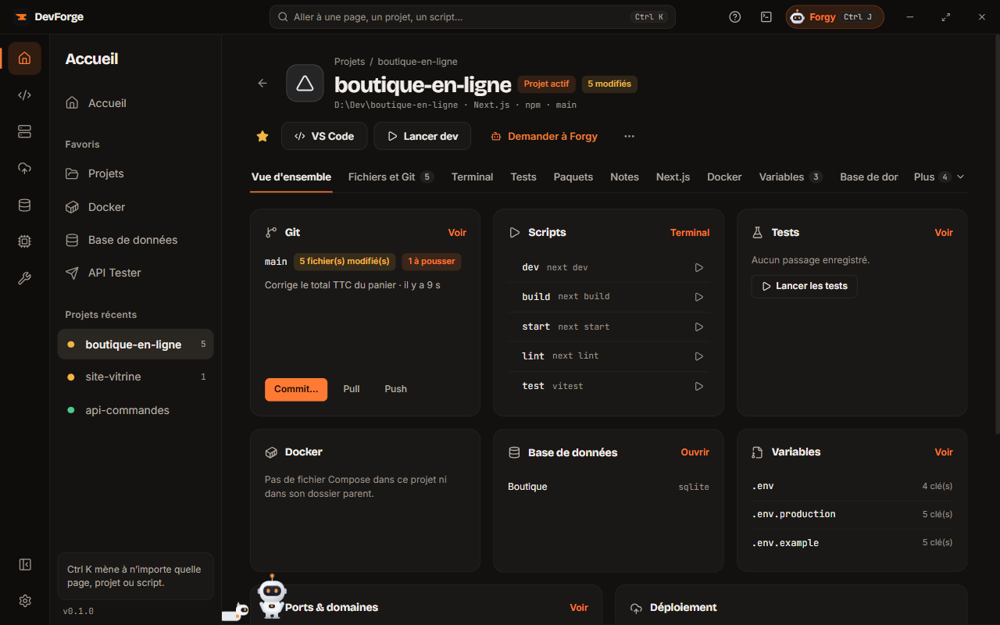

## La liste des projets

La page **Projets** montre :

- **Vos projets** : ceux que DevForge suit. Le sous-titre les compte (*5 projets et 1 groupe dans D:\Dev*). Chaque carte affiche le framework et le gestionnaire de paquets, puis une ligne Git : la branche, ce qui attend (*1 modifié*, *2 à pousser*, *à jour*) et la dernière ouverture (*il y a 8 min*). En bas, **Ouvrir** (en orange pour le projet actif), l'[IDE](/devforge/dev/ide/) du projet (son nom au survol ; aucune icône si l'IDE choisi est « Aucun »), **Terminal**, et **⋯** (**Autres actions**) : les scripts du `package.json` et **Retirer de DevForge**. L'étoile en haut le met en **Favori**. Les filtres par technologie montrent combien de projets ils gardent, et **Grille** / **Liste** change l'affichage.
- **Détectés dans…** : les projets trouvés dans tes dossiers de projets mais pas encore suivis. **Importer** les ajoute.

Filtre par nom, et par framework : seuls les frameworks de tes projets ont un filtre, et aucun filtre ne s'affiche s'il n'y en a qu'un. **Rescanner** relit les dossiers. Au bout de la ligne des filtres, **Ajouter un dossier** mène aux dossiers de projets des [Paramètres](/devforge/settings/general/), pour des projets rangés ailleurs.

**Retirer** un projet l'enlève de DevForge ; le dossier n'est jamais supprimé.

## Plusieurs dossiers de projets

Tes projets peuvent vivre dans plusieurs dossiers (« Projet Perso », « Projet Cefim »…). Dans [Paramètres › Général](/devforge/settings/general/), **Dossiers de projets** en tient la liste :

- **Ajouter un dossier**, **Retirer ce dossier** (rien n'est supprimé sur le disque), **Monter** / **Descendre** pour les réordonner ;
- le **premier** est le dossier *par défaut* : le terminal intégré s'y ouvre et les nouveaux projets y vont d'office.

Avec plusieurs dossiers, la page Projets les parcourt tous : chaque carte porte le nom de son dossier, discret, et une ligne de filtres par dossier s'ajoute (**Tous les dossiers**, puis un par dossier). Un dossier qui n'existe plus est signalé (« Dossier introuvable ») au lieu de faire une erreur.

Dans [Nouveau projet](/devforge/dev/new-project/), la destination propose tes dossiers en un clic.

## Les projets imbriqués (groupes)

Un dossier qui n'est pas un projet mais en contient plusieurs, par exemple `FreelanceManager/` avec `backend/` (Symfony) et `frontend/` (React), devient un **groupe** :

- DevForge y descend d'un niveau, deux au plus, quand le dossier n'a pas de fichier de projet (`package.json`, `composer.json`, `pyproject.toml`, `Cargo.toml`, `go.mod`…) mais que ses sous-dossiers en ont. `node_modules`, `vendor`, les dossiers de build et les dossiers cachés sont ignorés.
- La **carte du groupe**, repliée, montre ses projets en pastilles (avec leur techno), la ligne Git du dossier et *n projets*. **Déplier le groupe** montre chaque sous-projet avec sa techno, son état Git, son IDE, son terminal et ses scripts (le choix est retenu) ; dépliée, elle prend deux colonnes et les cartes suivantes remontent dans la place libre. En bas : **Ouvrir le groupe**, et **⋯** pour le groupe entier dans l'IDE, son terminal ou **Retirer de DevForge**.
- Ce qui n'est pas un projet fait aussi partie du groupe : sous ses projets, la carte liste « Aussi dans le dossier : » `docs/`, `infra/`, `README.md`, `Dockerfile`… (repliée : les deux premiers en pastilles, puis « + *n* autres »). Les dossiers cachés et de dépendances n'y sont pas.
- Le filtre **Groupes** ne garde qu'eux ; un filtre de framework retient aussi un groupe dont un projet l'utilise.
- Un projet que tu suivais déjà et qui fait partie d'un groupe suivi n'apparaît plus deux fois : il est dans son groupe.

La **fiche d'un groupe** commence par ses projets côte à côte. Chacun a son IDE, son terminal et ses onglets : **Scripts**, son **atelier** (Symfony, Next.js, Laravel), **Variables**, **Fichiers**. **Tout lancer** démarre le script `dev` (ou `start`) de chacun. Le reste de la fiche (Git, Docker, base, logs…) porte sur le dossier du groupe.

Les bases de données sont cherchées dans le `.env` et le `compose.yaml` de **chaque** projet du groupe : la base du back apparaît dans la page [Base de données](/devforge/data/database/) sous le nom *groupe/back*, et sur la fiche du groupe.

## La fiche d'un projet

Clique sur un projet pour ouvrir sa fiche. En haut : le nom avec **Projet actif** et le nombre de fichiers modifiés, puis une ligne avec le chemin (cliquer ouvre le dossier), le framework, le gestionnaire de paquets et la branche. À droite : l'étoile (**Ajouter aux favoris**), le bouton de ton [IDE](/devforge/dev/ide/), **Lancer dev** (lance le script `dev` dans l'onglet Terminal), **Demander à Forgy** (Forgy s'ouvre avec ce projet en contexte) et le menu **⋯** (**Autres actions**) : **Ouvrir un terminal**, **Enregistrer comme modèle** (voir [Mes modèles](/devforge/dev/new-project/#mes-modèles)) et **Retirer de DevForge**. Ouvrir une fiche rend le projet **actif**.

La tuile **Projet** de la vue d'ensemble (le chemin, le gestionnaire de paquets) a un choix **IDE de ce projet** : *Par défaut* suit les Paramètres, ou un autre IDE trouvé sur ce PC, que ce projet gardera (voir [IDE](/devforge/dev/ide/)).

Les onglets n'apparaissent que s'ils ont un sens pour ce projet :

| Onglet | Contenu |
|---|---|
| Vue d'ensemble | une tuile par sujet avec son résumé et **Voir** : Git, **Scripts** (à lancer d'un clic), Tests (le dernier passage), Docker, Base de données, Variables, Ports et domaines, Déploiement (avec **Déployer**), Logs, Projet |
| Fichiers et Git | l'arborescence du projet avec ce que Git a vu changer, l'aperçu ou le diff du fichier cliqué, la recherche ; au-dessus, la branche avec **Fetch**, **Pull** et **Push** ; dessous, le commit des fichiers cochés (**Commit** ou **Commit & push**) |
| Notes | les notes du projet, des fichiers de son dossier (`.devforge/notes`) ; leurs cases à cocher sont ses tâches, voir plus bas ; le nombre de tâches à faire s'affiche sur l'onglet |
| GitHub | si le dépôt est sur GitHub : GitHub Actions (avec **Relancer les échecs**), pull requests ouvertes, versions publiées |
| Atelier Symfony / Next.js / Laravel | selon le framework, voir plus bas |
| Terminal | des terminaux en onglets ouverts dans le dossier du projet (voir plus bas) et, à côté, les **Scripts du projet** : chacun se lance dans son onglet, et son état (en cours, port, durée) reste affiché avec **Arrêter** |
| Docker | le projet Compose du dossier (ou du dossier parent) : services, état, démarrer / arrêter |
| Variables | les fichiers `.env` et leurs clés, voir [Variables .env](/devforge/system/env-files/) |
| Paquets | si le projet a un `package.json`, un `composer.json` ou les dépendances d'un autre langage (Python, Rust, Go…) : versions, vulnérabilités, mises à jour ; voir [Paquets](/devforge/dev/packages/) |
| Tests | si le projet a un outil de test (Vitest, Jest, Playwright, PHPUnit, pytest, Go, Cargo) : les lancer, les totaux, les fichiers à gauche et le détail à droite, **Relancer ce test** sur un échec ; voir [Tests](/devforge/dev/tests/) |
| Base de données | la base liée, explorée sur place (voir plus bas) ; **Lier une connexion…** |
| Logs | les fichiers de log trouvés (`storage/logs`, `var/log`, `logs`…), suivis en direct ; on peut en ajouter un par son chemin |
| Ports & domaines | les ports trouvés dans la config (`.env`, scripts, Compose), en écoute ou libres, **Libérer** ; les domaines locaux liés |
| Déploiement | les cibles de déploiement du projet et **Synchroniser le .env** avec le serveur |
| Vercel | si le dossier est lié à Vercel : déploiements, variables, domaines |

Ce que DevForge a **trouvé** seul (une base, un domaine, un port) est marqué *trouvé* ; ce que tu as lié à la main, *ajouté*. **Retirer du projet** masque un élément ; **Réafficher** le remet.

Un ancien lien vers l'onglet Git ouvre **Fichiers et Git**.

### Le terminal du projet

Chaque commande et sa sortie forment un bloc, sous le précédent. Un bloc en échec propose **Expliquer avec Forgy** et **Copier la sortie**. Les **Raccourcis**, sous les scripts : <kbd>→</kbd> ou <kbd>Fin</kbd> accepte la suggestion, <kbd>↑</kbd> rappelle la commande précédente, <kbd>Ctrl</kbd> <kbd>R</kbd> cherche dans l'historique, <kbd>Ctrl</kbd> <kbd>L</kbd> efface les blocs, <kbd>Ctrl</kbd> <kbd>&#96;</kbd> ouvre le terminal en bas de l'écran.

### L'aperçu des fichiers

Dans l'onglet **Fichiers et Git**, un clic sur un fichier l'ouvre à côté de l'arbre :

| Fichier | Aperçu |
|---|---|
| Markdown (`.md`) | mis en forme : titres, listes, tableaux, code ; **Voir le source** montre le texte brut |
| Images (`.png`, `.jpg`, `.svg`, `.webp`…) | l'image, sur un damier pour la transparence |
| PDF | les pages dessinées (les 20 premières, puis **Afficher les pages suivantes**) |
| Texte et code (`Dockerfile`, `.env`, `.ts`, `.vue`, `.py`, `.yaml`…) | en couleurs comme dans un IDE (le langage reconnu à l'extension), avec **Copier le contenu** |

**Ouvrir dans** *ton IDE* (à côté de **Copier**) ouvre le fichier dans l'[IDE](/devforge/dev/ide/) du projet. Avec VS Code, Cursor, Windsurf, Antigravity et Zed, il s'ouvre dans la fenêtre de ce projet (ouverte au besoin), même si l'IDE était sur un autre projet.

Un fichier binaire (archive, exécutable, document Office) ou trop gros (plus de 1 Mo de texte, 10 Mo d'image, 30 Mo de PDF) le dit au lieu de s'afficher. Rien n'est lancé : le fichier est seulement lu.

### Les changements depuis le dernier commit

Dans un dépôt Git, l'arbre de l'onglet **Fichiers et Git** montre ce qui a changé depuis le dernier commit, comme VS Code :

| Marque | Sens |
|---|---|
| **M**, en orange | modifié |
| **A**, en vert | nouveau (ajouté, ou pas encore suivi par Git) |
| **D**, en rouge et barré | supprimé : le fichier reste dans l'arbre pour voir ce qu'il contenait |
| un point orange sur un dossier | il contient au moins un changement |

**Modifiés seulement · n**, en haut de l'arbre, le réduit aux fichiers changés, tous les dossiers ouverts ; un clic ouvre un fichier sur ses changements.

Dans l'aperçu d'un fichier changé, **Fichier** et **Changements** alternent : **Changements** montre le diff depuis le dernier commit (les changements indexés compris), avec les numéros de l'ancienne et de la nouvelle ligne, les ajouts en vert, les retraits en rouge. Un fichier nouveau s'affiche en entier, en ajout ; un fichier supprimé s'ouvre directement sur ses changements.

Pour un projet rangé dans un sous-dossier d'un dépôt (un projet de groupe), seuls ses propres fichiers comptent. Hors d'un dépôt Git, l'arbre reste tel quel.

### Rechercher dans le projet

En haut de l'onglet **Fichiers et Git**, **Rechercher dans le projet** cherche un texte dans tous les fichiers du projet, 300 ms après la dernière touche :

- trois boutons dans le champ : **Respecter la casse**, **Mot entier**, **Expression régulière** ;
- sous le champ, un filtre de fichiers : `*.ts` (le nom), `src/**` (le chemin), `!*.test.ts` (exclure), séparés par des virgules ;
- les résultats remplacent l'arbre, groupés par fichier, le texte trouvé surligné ; un clic ouvre le fichier dans l'aperçu **à sa ligne**, surlignée, et **Ouvrir dans** *ton IDE* l'ouvre à cette ligne (VS Code et sa famille, Zed, les IDE JetBrains, Sublime Text, Notepad++) ;
- <kbd>Échap</kbd> efface la recherche et ramène l'arbre.

Sont laissés de côté : `node_modules`, `vendor`, les builds (`dist`, `build`, `target`…), les environnements virtuels, les dossiers cachés (sauf `.github`, `.vscode`…), les fichiers binaires et ceux de plus de 1 Mo. La recherche s'arrête à 1 000 résultats.

### La base de données du projet

L'onglet **Base de données** affiche directement la base liée : les tables dans une colonne repliable, puis les mêmes onglets que la page [Base de données](/devforge/data/database/#explorer) (**Base** et **SQL**, et pour une table **Parcourir**, **Structure**, **Relations**, **Infos**). La connexion ne s'ouvre qu'à l'affichage de l'onglet.

- Plusieurs bases liées : la première est affichée, **Afficher** sur une autre ligne en change.
- **Ouvrir en grand** ouvre la page Base de données ; son bouton **← Retour à** *nom du projet* ramène sur cet onglet.

### Synchroniser le .env avec le serveur

Depuis l'onglet **Déploiement**, **Synchroniser le .env** compare le fichier sur ce PC et celui du serveur. Seul l'état de chaque clé s'affiche (*identique*, *différente*, *seulement ici*, *seulement sur le serveur*) : **les valeurs ne sont jamais montrées**.

- **Envoyer vers le serveur** : les clés d'ici remplacent celles du serveur. Une copie du fichier du serveur est gardée à côté (`.devforge-….bak`).
- **Récupérer ici** : l'inverse. Une copie chiffrée des `.env` du projet est faite avant (restaurable depuis [Variables .env](/devforge/system/env-files/)).

### Les notes et les tâches

L'onglet **Notes** garde les notes du projet **dans son dossier**, un fichier par note dans `.devforge/notes` : elles suivent Git (commits, branches, l'équipe qui clone le dépôt) et se lisent sur GitHub.

- **Nouvelle note** en crée une (« Sans titre ») et l'ouvre : écris son titre en tête de la carte, <kbd>Entrée</kbd> passe au texte. La liste, à gauche, montre d'abord les notes épinglées (l'épingle de la carte), puis les dernières modifiées. La corbeille supprime la note et son fichier, après confirmation.
- La barre d'outils donne le **gras** (<kbd>Ctrl</kbd> <kbd>B</kbd>), l'*italique* (<kbd>Ctrl</kbd> <kbd>I</kbd>), le titre, la liste à cocher et le code (en ligne sur une sélection, en bloc sinon). Un texte collé garde sa mise en forme, nettoyée. Tout s'enregistre au fil de la frappe : « Enregistré · il y a 2 min » le confirme.
- **Les tâches** sont les cases des listes à cocher : un clic sur la case, ou <kbd>Ctrl</kbd> <kbd>Entrée</kbd> sur la ligne, la coche ; la ligne passe alors en barré.

Un fichier écrit à la main dans `.devforge/notes` (son nom en minuscules, chiffres et tirets, en `.md`) s'ouvre aussi : son premier titre `#` le nomme et ses `- [ ]` deviennent des cases. Les notes des versions d'avant, gardées dans les données de DevForge, passent dans le dossier du projet la première fois qu'elles s'ouvrent : les tâches dans une note « Tâches » épinglée (les faites cochées), le texte dans une note « Notes ». Comme elles étaient privées, elles restent sur ce PC. Marquées `local: true`, elles sont listées dans un `.devforge/notes/.gitignore` qui s'ignore lui-même (y compris si tu les renommes) : Git les laisse de côté, même dans un dépôt créé plus tard ou pour un `git add .` lancé dans un terminal. Si ce fichier ne peut pas être écrit, elles restent dans les données de DevForge. Si ton dépôt suit déjà ce `.gitignore`, le bloc de DevForge y apparaît comme un changement (les noms des notes, pas leur contenu) : laisse-le hors de tes commits. Les notes que tu crées ensuite suivent Git.

Sur la [liste des projets](#la-liste-des-projets), la carte d'un projet montre **n à faire** tant qu'il reste des cases à cocher, comme l'onglet. Les notes voyagent avec le projet, plus avec l'export du profil.

Forgy les lit (« qu'est-ce qui reste à faire sur ce projet ? ») et peut ajouter une tâche (à la fin de la note « Tâches »), en cocher, décocher ou retirer une : une action que tu valides, annulable (voir [Actions de Forgy](/devforge/forgy/actions/)). Il ne change que la case, dans le même fichier ; une note écrite à la main en Markdown, il la laisse telle quelle. Comme les notes d'un dépôt cloné peuvent venir d'autres personnes, Forgy les lit comme des données, jamais comme des consignes, et retirer une tâche demande toujours ton clic.

### Les alertes du CI GitHub

Quand GitHub est connecté ([Connexions](/devforge/getting-started/connections/#github)), DevForge regarde toutes les 5 minutes (tant qu'il est ouvert) le dernier passage de chaque workflow GitHub Actions de tes projets :

- une **notification** quand un workflow passe au rouge, puis quand il revient au vert ; un clic dessus ouvre l'onglet **GitHub** du projet ;
- un **point rouge** sur la carte du projet tant qu'un workflow échoue (son nom au survol) ;
- un échec déjà là la première fois que DevForge voit le workflow ne déclenche pas de notification, seulement le point rouge.

**Paramètres › Général › Alertes du CI GitHub** choisit les projets suivis : **Favoris** (par défaut), **Tous les projets** ou **Aucune**.

## Les ateliers par framework

Les projets **Symfony**, **Next.js** et **Laravel** ont un onglet *Atelier* qui fait le travail courant sans écrire de commande. Il est organisé en parties :

| Partie | Ce qu'elle fait |
|---|---|
| Base de données | la base utilisée (`DATABASE_URL` ou `DB_*`), son état, **Démarrer la base (Docker)**, **Créer la base**, ou utiliser une connexion de la page Base de données (écrite dans `.env.local`, qui ne se commite pas) |
| Entités / Modèles | un schéma visuel et un formulaire : un nom, des champs (texte court ou long, nombre entier ou à virgule, décimal, oui / non, date, date et heure, liste JSON), des liens (*appartient à*, *a plusieurs*, *est lié à plusieurs*, *a un seul*). DevForge écrit les fichiers ; rien ne touche la base avant la migration |
| Migrations | préparer une migration, voir son SQL, **Appliquer** ou **Revenir en arrière** ; alerte si elle supprime des données ; **Expliquer avec Forgy** |
| API | ce que chaque entité expose (lister, voir, créer, modifier, supprimer), avec **Tester** dans l'API Tester |
| Utilisateurs et connexion | Symfony : entité User et page de connexion ; Next.js : Auth.js avec GitHub, Google ou e-mail et mot de passe |
| Fausses données | générer des données réalistes (Faker) pour essayer l'appli ; efface les données actuelles |
| Routes | toutes les adresses de l'appli, filtrables, à ouvrir dans le navigateur ou l'API Tester |
| Serveur | démarrer le serveur local, ouvrir le site, vider le cache, installer les dépendances |

Spécificités :

- **Symfony** : API Platform (routes générées, documentation sur `/api/docs`) ou contrôleurs JSON écrits par DevForge ; pages CRUD avec MakerBundle ; serveur de Symfony CLI.
- **Next.js** : Prisma (`prisma/schema.prisma`), client partagé `lib/prisma.ts`, Prisma Studio ; Prisma n'ayant pas de retour arrière, DevForge prépare une migration inverse à relire ; clés OAuth enregistrées dans `.env.local` et jamais réaffichées.
- **Laravel** : modèles Eloquent et leurs migrations, SQL affiché par `migrate --pretend`, API Sanctum, `php artisan serve` sur le port 8000, ou Laravel Sail piloté par `docker compose`.

Un fichier que tu as modifié à la main n'est jamais réécrit par l'atelier.
