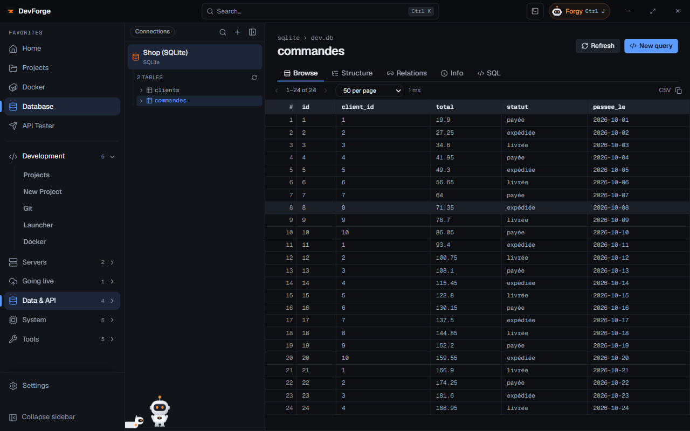

The **Database** page is a client for **PostgreSQL**, **MySQL / MariaDB** and **SQLite**. Passwords are encrypted by Windows.

## Adding a connection

**+** opens the form:

| Field | Detail |
|---|---|
| Type | PostgreSQL, MySQL / MariaDB or SQLite |
| Name | optional, defaults to `database@host` |
| Host, port, user, password, database | for PostgreSQL and MySQL |
| SQLite file | for SQLite |
| Connect through | **Direct connection**, or an SSH server: the connection then goes through an **SSH tunnel**, nothing to open on the server. Host and port are those seen from the server (`127.0.0.1` for a local service) |

**Test connection** checks before saving.

## Find databases

**Find databases** looks for databases to add without typing anything:

- **On a server (SSH)**: Docker PostgreSQL / MySQL / MariaDB containers (credentials read from their config) and services installed on the server. These databases go through an SSH tunnel.
- **In your projects (.env)**: the databases described in your projects' `.env` files.

**Add** saves a database found. The *Databases on this server* button of the [SSH](/devforge/en/servers/ssh/) page opens this search directly.

## Explore

Pick a connection: the list of tables (filterable) shows. The **Database** tab sums up the server, the database, the number of tables, views and rows (estimate), indexes and foreign keys.

For a table:

| Tab | Content |
|---|---|
| Browse | the rows, page by page, sortable by clicking a column |
| Structure | columns (type, null, default, key, extra, comment) and indexes; add, edit or drop a column, rename or drop the table (see below) |
| Relations | foreign keys to other tables, and tables pointing to this one |
| SQL | a query on this table |
| Info | rows, size (data and indexes), engine, collation, encoding, definition (DDL) |

## Creating and changing tables

- **New table** (the **+** at the top of the tables list): its name and columns. An auto-incremented `id` column is ready; each column has a **type** (offered per database, or typed: `VARCHAR(255)`, `NUMERIC(10, 2)`…), a **default**, and the boxes **Required**, **Primary key**, **Auto-increment**.
- In **Structure**: **Add a column**, a column's pencil to edit it (name, type, default, required), its bin to drop it; **Rename the table**; **Drop the table**, which asks for its name typed again.

Each dialog first shows the **query about to run**; nothing runs before **Apply**. If the database refuses, its message stays on screen and nothing else runs.

A default is kept as is when it is a number, a keyword (`CURRENT_TIMESTAMP`, `NULL`, `TRUE`…), a function (`now()`) or a string already in quotes; otherwise it is quoted.

**SQLite** can only rename a column: to change its type, default or "Required", the dialog points to the **SQL** tab.

## SQL queries

**New query** opens an SQL editor. <kbd>Ctrl</kbd> <kbd>Enter</kbd> runs it. Results are limited to 1000 rows; a write query shows the number of rows changed. Above the results, **CSV** or **JSON** picks the copy format (remembered): in JSON, one object per row.

## Elsewhere

- A database can be linked to a project: the **Database** tab of its [page](/devforge/en/dev/projects/#the-projects-database) explores it in place. **Open full size** leads here, and **← Back to** *project name* takes you back.
- [New Project](/devforge/en/dev/new-project/) adds the database it creates here.
- Forgy reads the structure of the tables (never the data) when this page is open, writes SQL and can run a query after your approval, with guardrails (see [Actions](/devforge/en/forgy/actions/#guardrails)).
