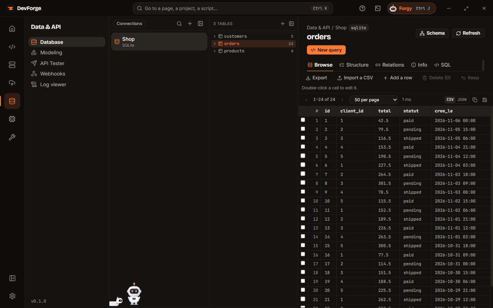

The **Database** page is a client for **PostgreSQL**, **MySQL / MariaDB** and **SQLite**. Passwords are encrypted by Windows.

## Adding a connection

**+** opens the form:

| Field | Detail |
|---|---|
| Type | PostgreSQL, MySQL / MariaDB or SQLite |
| Name | optional, defaults to `database@host` |
| Host, port, user, password, database | for PostgreSQL and MySQL |
| SQLite file | for SQLite, a file on this PC: a file on a network share is refused, since Windows would send your login to it |
| Connect through | **Direct connection**, or an SSH server: the connection then goes through an **SSH tunnel**, nothing to open on the server. Host and port are those seen from the server (`127.0.0.1` for a local service) |

**Test connection** checks before saving.

When editing, a password left empty keeps the saved one, as long as the database stays at the same place. If its type, host, port, user or SSH server changes, the password is forgotten and the form asks for it again: it never goes to another machine.

## Find databases

**Find databases** looks for databases to add without typing anything:

- **On a server (SSH)**: Docker PostgreSQL / MySQL / MariaDB containers (credentials read from their config) and services installed on the server. These databases go through an SSH tunnel. A container is kept only if the server can reach it: a published port, or an address of its private network.
- **In your projects (.env)**: the databases described in your projects' `.env` files. A database whose host is one of your servers goes through it. If several servers are saved there on different ports, DevForge does not guess: pick the right one in **Connect through**.

**Add** saves a database found. The *Databases on this server* button of the [SSH](/devforge/en/servers/ssh/) page opens this search directly.

## Explore

The **Connections** panel, on the left, lists your databases. Pick one: its tables (filterable) unfold under it, with the number of rows of each (an estimate on PostgreSQL and MySQL). At the bottom of the panel, a reminder: passwords are encrypted by Windows. Above the title, "Data & API / connection name" leads back to the database overview. The tabs are top right, next to **Schema** and the **⋯** menu (**Refresh**, **Search the database**, **New table**, **New query**). The **Database** tab sums up the server, the database, the number of tables, views and rows (estimate), indexes and foreign keys.

For a table:

| Tab | Content |
|---|---|
| Data | the rows, page by page, sortable by clicking a column; editable (see below), exportable, and a CSV imports into it |
| Structure | columns (type, null, default, key, extra, comment) and indexes; add, edit or drop a column, rename or drop the table (see below) |
| Relations | foreign keys to other tables, and tables pointing to this one |
| SQL | a query on this table |
| Info | rows, size (data and indexes), engine, collation, encoding, definition (DDL) |

## Searching the database

The **Search** tab (or **Search the database** in the **⋯** menu) looks for a value in **every table at once**, like phpMyAdmin's search, made simpler:

- Type what you are looking for, then <kbd>Enter</kbd>. Every column is read as text: numbers, dates and JSON included.
- The **mode**: **Contains the text** (the default), **Any of the words**, **All the words** (each word somewhere in the row), **Exact value** or **Regular expression**. For words, quotes keep a phrase whole: `"main street"`.
- **Match case**: without it, upper and lower case are the same, accented letters included (`élodie` finds `Élodie`).
- **In the column** narrows the search to the columns of that name (suggested from the tables); only the tables that have it are searched.
- **Tables**: all of them by default, views left out; unfold the list to tick some.

Tables are searched one by one, and each shows as soon as it has answered; **Stop** ends the search. For each table that holds the term: the number of rows found, the columns it is in, and the first 50 rows, the key and those columns first, the term highlighted. **Show the SQL** puts the query that brings back every row in the **SQL** tab; **Open the table** shows its data. The results are still there when you come back to the tab.

The search only reads, and the term goes in as a parameter, never pasted into the SQL. Each table searched is read whole: on a big database, stick to one column or a few tables. Regular expressions follow the database's syntax: POSIX for PostgreSQL, ICU or PCRE for MySQL / MariaDB, JavaScript for SQLite.

## The schema

**Schema** (top right) opens the database full screen: each table as a card, with its columns, their type, the primary key 🔑 and the required columns (`!`). One arrow per foreign key goes from the column that points to the column pointed at.

- **Automatic layout**: the tables pointed at on the left, the ones pointing at them on the right, ordered so arrows cross little. Tables without links go below.
- **Move** a table: drag it by its title. Positions are kept for each database; **Rearrange** goes back to the automatic layout.
- **Navigate**: drag the background to move around, the wheel zooms, **Fit** shows everything. The **minimap** at the bottom right shows the part on screen; a click on it goes there.
- **Tables shown**: the list on the left checks and searches them; **+ neighbours** adds those linked to the checked tables. Over 60 tables, none is shown at first: check the ones you care about.
- A click on a table's title opens its **Structure**.
- **PNG** or **SVG** saves the schema as an image, in the theme's colours.

PostgreSQL (all schemas), MySQL / MariaDB and SQLite.

## Creating and changing tables

- **New table** (in the **⋯** menu, or the tables' **+** in a project's tab): its name and columns. An auto-incremented `id` column is ready; each column has a **type** (offered per database, or typed: `VARCHAR(255)`, `NUMERIC(10, 2)`…), a **default**, and the boxes **Required**, **Primary key**, **Auto-increment**.
- In **Structure**: **Add a column**, a column's pencil to edit it (name, type, default, required), its bin to drop it; **Rename the table**; **Drop the table**, which asks for its name typed again.

Each dialog first shows the **query about to run**; nothing runs before **Apply**. If the database refuses, its message stays on screen and nothing else runs.

A default is kept as is when it is a number, a keyword (`CURRENT_TIMESTAMP`, `NULL`, `TRUE`…), a function (`now()`) or a string already in quotes; otherwise it is quoted.

**SQLite** can only rename a column: to change its type, default or "Required", the dialog points to the **SQL** tab.

## Editing rows

In **Data**, a table with a **primary key** is edited in place:

- **double-click** (or <kbd>Enter</kbd>) a cell to edit it; **NULL** in one click next to the field; <kbd>Esc</kbd> cancels;
- **Add a row**: an empty row at the top; a cell left empty keeps the column's default (an auto-increment, say);
- check rows, then **Delete**: they are struck through; **Keep** takes them back.

Pending changes are highlighted; while there are some, the page and the sort stay put. **Apply (n changes)** shows the `UPDATE`, `INSERT` and `DELETE` queries, then runs them **in one transaction**: if one fails, none is kept and the database's message stays on screen. **Drop the changes** forgets them.

Values travel as parameters, never pasted into the SQL. A table without a primary key, a view and the SQL tab's results stay read only; binary columns are not edited here.

## Import and export

- **Export** (in **Data**) writes **the whole table** to a file, not just the page shown: **CSV**, **JSON**, **SQL** (`INSERT`s) or **SQL with CREATE TABLE**. Rows are read 1,000 at a time, in primary key order.
- A query's results can be saved too, as CSV or JSON, with the button next to **Copy**.
- **Import a CSV**: pick the file; the separator (`,`, `;`, tab, `|`) and the encoding (UTF-8, or Windows-1252 as Excel's CSVs) are recognised. Each column of the file goes into the table's column of the same name (case, spaces, `_` and `-` ignored); under each header you change it or skip it. The first 10 rows show; **An empty cell becomes NULL** is checked by default.
- The import runs **in one transaction**: if a row is refused (a required column empty, a duplicate key…), none is kept and the file's faulty line is given. 50 MB at most.

Files always go through Windows' save or open window.

## SQL queries

The **SQL** tab (or **New query** in the **⋯** menu) opens an SQL editor. **Run** or <kbd>Ctrl</kbd> <kbd>Enter</kbd> runs the query; **Write with Forgy** asks it to write or fix it from the database's structure. Results are limited to 1000 rows; a write query shows the number of rows changed. Above the results, **CSV** or **JSON** picks the copy format (remembered): in JSON, one object per row.

## Elsewhere

- A database can be linked to a project: the **Database** tab of its [page](/devforge/en/dev/projects/#the-projects-database) explores it in place. **Open full size** leads here, and **← Back to** *project name* takes you back.
- [New Project](/devforge/en/dev/new-project/) adds the database it creates here.
- Forgy reads the structure of the tables (never the data) when this page is open, writes SQL and can run a query after your approval, with guardrails (see [Actions](/devforge/en/forgy/actions/#guardrails)).
