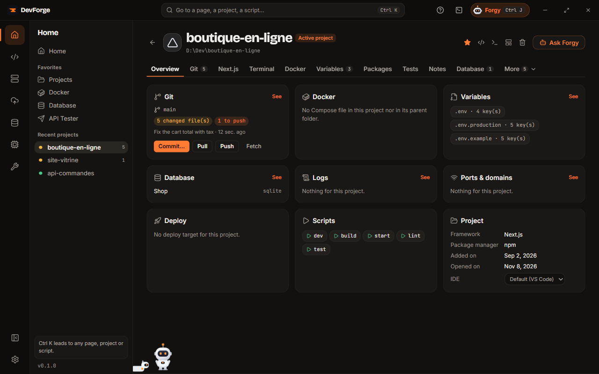

## The project list

The **Projects** page shows:

- **Your Projects**: the ones DevForge tracks. The subtitle counts them (*5 projects and 1 group in D:\Dev*). Each card shows the framework and the package manager, then a Git line: the branch, what is waiting (*1 changed*, *2 to push*, *up to date*) and the last opening (*8 min ago*). At the bottom, **Open** (in orange for the active project), the project's [IDE](/devforge/en/dev/ide/) (its name on hover; no icon when the chosen IDE is "None"), **Terminal**, and **⋯** (**Other actions**): the `package.json` scripts and **Remove from DevForge**. The star at the top makes it a **Favorite**. The stack filters show how many projects they keep, and **Grid** / **List** changes the view.
- **Detected in…**: projects found in your projects folders but not tracked yet. **Import** adds them.

Filter by name, and by framework: only your projects' frameworks get a filter, and none shows when there is only one. **Rescan** reads the folders again. At the end of the filters row, **Add a folder** leads to the projects folders in [Settings](/devforge/en/settings/general/), for projects kept elsewhere.

**Remove** takes a project out of DevForge; the folder is never deleted.

## Several projects folders

Your projects may live in several folders ("Personal", "School"…). In [Settings › General](/devforge/en/settings/general/), **Projects folders** keeps their list:

- **Add a folder**, × to remove one (nothing is deleted on disk); another folder's icon turns into a star on hover: a click makes it the default;
- the **first** one is the *default*: the built-in terminal opens there and new projects go there unless you pick another.

With several folders, the Projects page scans them all: each card bears its folder's name, discreetly, and a row of folder filters appears (**All folders**, then one per folder). A folder that no longer exists is reported ("Folder not found") instead of failing.

In [New project](/devforge/en/dev/new-project/), the destination offers your folders in one click.

## Nested projects (groups)

A folder that is not a project but holds several, for instance `FreelanceManager/` with `backend/` (Symfony) and `frontend/` (React), becomes a **group**:

- DevForge looks one level down, two at most, when the folder has no project file (`package.json`, `composer.json`, `pyproject.toml`, `Cargo.toml`, `go.mod`…) but its sub-folders do. `node_modules`, `vendor`, build folders and hidden folders are skipped.
- The **group's card**, folded, shows its projects as chips (with their stack), the folder's Git line and *n projects*. **Unfold the group** shows each project with its stack, Git state, IDE, terminal and scripts (remembered); unfolded, it spans two columns and the next cards move up into the free room. At the bottom: **Open the group**, and **⋯** for the whole group in the IDE, its terminal or **Remove from DevForge**.
- What is not a project is part of the group too: under its projects, the card lists "Also in the folder:" `docs/`, `infra/`, `README.md`, `Dockerfile`… (folded: the first two as chips, then "+ *n* more"). Hidden and dependency folders are left out.
- The **Groups** filter keeps only them; a framework filter also keeps a group one of whose projects uses it.
- A project you already tracked that sits in a tracked group no longer shows twice: it is in its group.

A **group's page** starts with its projects side by side. Each has its IDE, its terminal and its tabs: **Scripts**, its **workshop** (Symfony, Next.js, Laravel), **Variables**, **Files**. **Run them all** starts each one's `dev` (or `start`) script. The rest of the page (Git, Docker, database, logs…) is about the group's folder.

Databases are looked for in the `.env` and `compose.yaml` of **each** project of the group: the back's database shows on the [Database](/devforge/en/data/database/) page as *group/back*, and on the group's page.

## A project's page

Click a project to open its page. At the top: the name with **Active project** and the number of changed files, then a line with the path (click to open the folder), the framework, the package manager and the branch. On the right: the star (**Add to favorites**), the button of your [IDE](/devforge/en/dev/ide/), **Run dev** (runs the `dev` script in the Terminal tab), **Ask Forgy** (Forgy opens with this project in context) and the **⋯** menu (**Other actions**): **Open a terminal**, **Save as template** (see [My templates](/devforge/en/dev/new-project/#my-templates)) and **Remove from DevForge**. Opening a project's page makes it **active**.

The overview's **Project** tile has an **IDE of this project** choice: *Default* follows Settings, or another IDE found on this PC that this project keeps (see [IDE](/devforge/en/dev/ide/)).

Tabs only show when they make sense for the project:

| Tab | Content |
|---|---|
| Overview | one tile per topic with its summary and **See**: Git, **Scripts** (one click runs one), Tests (the last run), Docker, Database, Variables, Ports and domains, Deployment (with **Deploy**), Logs, Project |
| Files & Git | the project tree with what Git saw change, the preview or diff of the file clicked, the search; above, the branch with **Fetch**, **Pull** and **Push**; below, the commit of the ticked files (**Commit** or **Commit & push**) |
| Notes | the project's notes, files of its folder (`.devforge/notes`); their checkboxes are its tasks, see below; the number of open tasks shows on the tab |
| GitHub | if the repository is on GitHub: GitHub Actions (with **Re-run failed jobs**), open pull requests, releases |
| Symfony / Next.js / Laravel workshop | depending on the framework, see below |
| Terminal | terminals in tabs opened in the project folder (see below) and, next to them, **The project's scripts**: each runs in its own tab, and its state (running, port, time) stays shown with **Stop** |
| Docker | the Compose project of the folder (or its parent): services, state, start / stop |
| Variables | the `.env` files and their keys, see [Env variables](/devforge/en/system/env-files/) |
| Packages | when the project has a `package.json`, a `composer.json` or another language's dependencies (Python, Rust, Go…): versions, vulnerabilities, updates; see [Packages](/devforge/en/dev/packages/) |
| Tests | when the project has a test tool (Vitest, Jest, Playwright, PHPUnit, pytest, Go, Cargo): run them, the totals, the files on the left and the detail on the right, **Run this test again** on a failure; see [Tests](/devforge/en/dev/tests/) |
| Database | the linked database, explored in place (see below); **Link a connection…** |
| Logs | the log files found (`storage/logs`, `var/log`, `logs`…), followed live; you can add one by its path |
| Ports & domains | the ports found in the config (`.env`, scripts, Compose), listening or free, **Free**; the linked local domains |
| Deploy | the project's deploy targets and **Sync the .env** with the server |
| Vercel | if the folder is linked to Vercel: deployments, variables, domains |

What DevForge **found** by itself (a database, a domain, a port) is marked *found*; what you linked by hand, *added*. **Remove from the project** hides an item; **Show again** brings it back.

An old link to the Git tab opens **Files & Git**.

### The project's terminal

Each command and its output make a block, under the previous one. A failed block offers **Explain with Forgy** and **Copy the output**. The **Shortcuts**, under the scripts: <kbd>→</kbd> or <kbd>End</kbd> accepts the suggestion, <kbd>↑</kbd> brings back the previous command, <kbd>Ctrl</kbd> <kbd>R</kbd> searches the history, <kbd>Ctrl</kbd> <kbd>L</kbd> clears the blocks, <kbd>Ctrl</kbd> <kbd>&#96;</kbd> opens the terminal at the bottom of the screen.

### File previews

In the **Files & Git** tab, clicking a file opens it next to the tree:

| File | Preview |
|---|---|
| Markdown (`.md`) | formatted: headings, lists, tables, code; **Show source** shows the raw text |
| Images (`.png`, `.jpg`, `.svg`, `.webp`…) | the image, on a checkerboard for transparency |
| PDF | the pages drawn (the first 20, then **Show the next pages**) |
| Text and code (`Dockerfile`, `.env`, `.ts`, `.vue`, `.py`, `.yaml`…) | in colours as in an IDE (the language told by the extension), with **Copy the content** |

**Open in** *your IDE* (next to **Copy**) opens the file in the project's [IDE](/devforge/en/dev/ide/). With VS Code, Cursor, Windsurf, Antigravity and Zed, it opens in that project's window (opened if needed), even when the IDE was on another project.

A binary file (archive, program, Office document) or one too big (over 1 MB of text, 10 MB of image, 30 MB of PDF) says so instead. Nothing runs: the file is only read.

### Changes since the last commit

In a Git repository, the **Files & Git** tab's tree shows what changed since the last commit, as VS Code does:

| Mark | Meaning |
|---|---|
| **M**, orange | modified |
| **A**, green | new (added, or not tracked by Git yet) |
| **D**, red and struck through | deleted: the file stays in the tree to see what it held |
| an orange dot on a folder | it holds at least one change |

**Modified only · n**, at the top of the tree, reduces it to the changed files, every folder open; a click opens a file on its changes.

In a changed file's preview, **File** and **Changes** switch: **Changes** shows the diff since the last commit (staged changes included), with the old and new line numbers, additions in green, removals in red. A new file shows whole, as added; a deleted file opens straight on its changes.

For a project kept in a sub-folder of a repository (a group's project), only its own files count. Outside a Git repository, the tree stays as it is.

### Searching the project

At the top of the **Files & Git** tab, **Search the project** looks for a text in every file of the project, 300 ms after the last key:

- three buttons in the field: **Match case**, **Whole word**, **Regular expression**;
- under the field, a file filter: `*.ts` (the name), `src/**` (the path), `!*.test.ts` (leave out), comma-separated;
- the results replace the tree, grouped by file, the text found highlighted; a click opens the file in the preview **at its line**, highlighted, and **Open in** *your IDE* opens it at that line (VS Code and its family, Zed, the JetBrains IDEs, Sublime Text, Notepad++);
- <kbd>Esc</kbd> clears the search and brings the tree back.

Left out: `node_modules`, `vendor`, builds (`dist`, `build`, `target`…), virtual environments, hidden folders (but `.github`, `.vscode`…), binary files and files over 1 MB. The search stops at 1,000 results.

### The project's database

The **Database** tab shows the linked database right there: the tables in a collapsible column, then the same tabs as the [Database](/devforge/en/data/database/#explore) page (**Database** and **SQL**, and for a table **Data**, **Structure**, **Relations**, **Info**). The connection only opens when the tab shows.

- Several linked databases: the first one shows, **Show** on another row switches.
- **Open full size** opens the Database page; its **← Back to** *project name* button brings you back to this tab.

### Sync the .env with the server

From the **Deploy** tab, **Sync the .env** compares the file on this PC and the one on the server. Only the state of each key shows (*same*, *different*, *only here*, *only on the server*): **values are never displayed**.

- **Send to the server**: the keys from here replace the server's. A copy of the server's file is kept next to it (`.devforge-….bak`).
- **Bring here**: the other way round. An encrypted copy of the project's `.env` files is made first (restorable from [Env variables](/devforge/en/system/env-files/)).

### Notes and tasks

The **Notes** tab keeps the project's notes **in its folder**, one file per note in `.devforge/notes`: they follow Git (commits, branches, the team that clones the repository) and read well on GitHub.

- **New note** makes one ("Untitled") and opens it: type its title at the top of the card, <kbd>Enter</kbd> moves on to the text. The list, on the left, shows the pinned notes first (the card's pin), then the last changed. The bin deletes the note and its file, after a confirmation.
- The toolbar gives **bold** (<kbd>Ctrl</kbd> <kbd>B</kbd>), *italic* (<kbd>Ctrl</kbd> <kbd>I</kbd>), heading, checklist and code (inline on a selection, a block otherwise). Pasted text keeps its formatting, cleaned. Everything is saved as you type: "Saved · 2 min ago" confirms it.
- **Tasks** are the boxes of the checklists: a click on the box, or <kbd>Ctrl</kbd> <kbd>Enter</kbd> on the line, checks it; the line is then struck through.

A file written by hand in `.devforge/notes` (its name in lower-case letters, digits and dashes, ending in `.md`) opens too: its first `#` heading names it and its `- [ ]` become boxes. Notes from earlier versions, kept in DevForge's data, move into the project's folder the first time they open: the tasks into a pinned "Tasks" note (done ones checked), the text into a "Notes" note. As they were private, they stay on this PC. Marked `local: true`, they are listed in a `.devforge/notes/.gitignore` that leaves itself out too (renamed ones included): Git leaves them aside, even in a repository made later or for a `git add .` run in a terminal. If that file cannot be written, they stay in DevForge's data. If your repository already tracks this `.gitignore`, DevForge's block shows in it as a change (the notes' names, not their content): leave it out of your commits. The notes you make afterwards follow Git.

On the [project list](#the-project-list), a project's card shows **n to do** while boxes are left to check, as the tab does. Notes travel with the project, no longer with the profile export.

Forgy reads them ("what is left to do on this project?") and can add a task (at the end of the "Tasks" note), check, uncheck or remove one: an action you confirm, which can be undone (see [Forgy's actions](/devforge/en/forgy/actions/)). It changes only the box, in the same file; a note written by hand in Markdown, it leaves as it is. As the notes of a cloned repository may come from other people, Forgy reads them as data, never as instructions, and removing a task always waits for your click.

### GitHub CI alerts

When GitHub is connected ([Connections](/devforge/en/getting-started/connections/#github)), DevForge checks every 5 minutes (while it is open) the latest run of each GitHub Actions workflow of your projects:

- a **notification** when a workflow turns red, then when it is green again; a click opens the project's **GitHub** tab;
- a **red dot** on the project's card while a workflow fails (its name on hover);
- a failure already there the first time DevForge sees the workflow does not notify, it only shows the red dot.

**Settings › General › GitHub CI alerts** picks the projects followed: **Favourites** (default), **All projects** or **None**.

## Framework workshops

**Symfony**, **Next.js** and **Laravel** projects have a *workshop* tab that does the everyday work without typing commands. It is split into parts:

| Part | What it does |
|---|---|
| Database | the database in use (`DATABASE_URL` or `DB_*`), its state, **Start the database (Docker)**, **Create the database**, or use a connection from the Database page (written to `.env.local`, which is not committed) |
| Entities / Models | a visual schema and a form: a name, fields (short or long text, integer or decimal number, price decimal, yes / no, date, date and time, JSON list), links (*belongs to*, *has many*, *is linked to many*, *has one*). DevForge writes the files; nothing touches the database before the migration |
| Migrations | prepare a migration, see its SQL, **Apply** or **Roll back**; warning if it deletes data; **Explain with Forgy** |
| API | what each entity exposes (list, show, create, update, delete), with **Test** in the API Tester |
| Users and sign-in | Symfony: User entity and login page; Next.js: Auth.js with GitHub, Google or e-mail and password |
| Fake data | generate realistic data (Faker) to try the app; erases the current data |
| Routes | every address of the app, filterable, to open in the browser or the API Tester |
| Server | start the local server, open the site, clear the cache, install dependencies |

Specifics:

- **Symfony**: API Platform (generated routes, documentation at `/api/docs`) or JSON controllers written by DevForge; CRUD pages with MakerBundle; Symfony CLI's server.
- **Next.js**: Prisma (`prisma/schema.prisma`), shared client `lib/prisma.ts`, Prisma Studio; since Prisma has no rollback, DevForge prepares a reverse migration to review; OAuth keys saved in `.env.local` and never shown again.
- **Laravel**: Eloquent models and their migrations, SQL shown by `migrate --pretend`, Sanctum API, `php artisan serve` on port 8000, or Laravel Sail driven through `docker compose`.

A file you edited by hand is never rewritten by the workshop.
