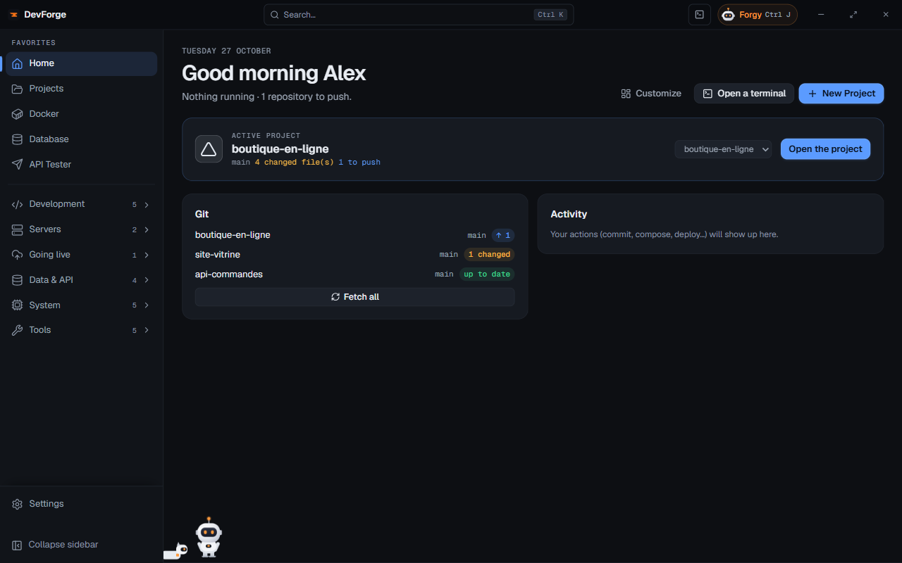
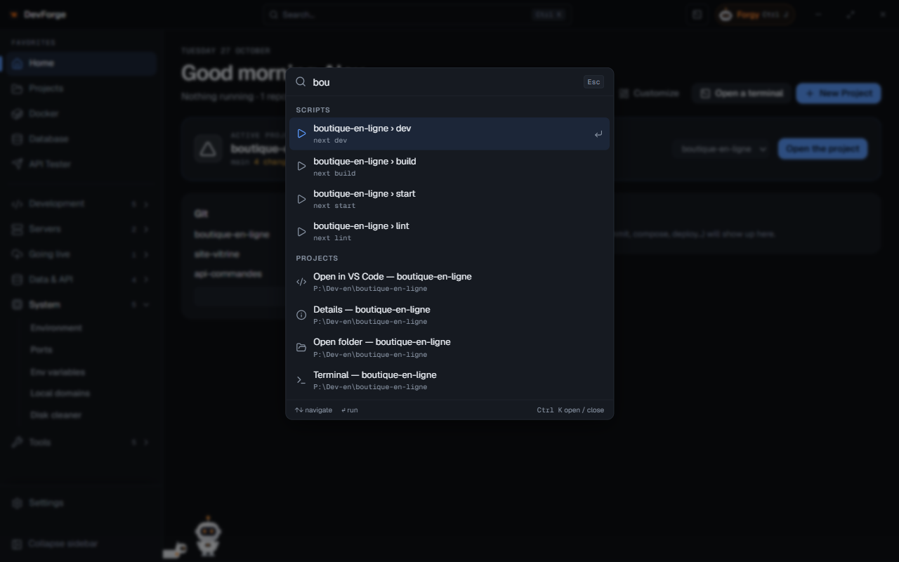

## Home

Home greets you according to the time of day and sums up what is running: containers online, ports listening, repositories to push, server state. It is made of **widgets**:

| Widget | What it shows |
|---|---|
| Active project | the current project and its quick actions (open, terminal, scripts) |
| Docker | Compose projects and their services, with Start / Stop / Logs |
| VPS | the SSH connection, the server's memory and disk |
| Git | repositories with changes or commits to push, **Fetch all** |
| Ports | dev ports listening |
| Activity | your latest actions (commit, Compose, deployment, Forgy's actions…) |
| VPS health, VPS services, Backups, n8n, VPN | a summary of each server page |

**Customize** lets you drag widgets (or <kbd>Alt</kbd> + <kbd>↑</kbd> <kbd>↓</kbd> on their handle), make them full or half width, remove or add some. **Defaults** brings back the original layout.

### The active project

One project can be **active**: Forgy and the desktop widget refer to it. It becomes active when you open it, or is picked in the *Active project* widget.

## The menu

The left menu starts with **Home** and your **favorites**, then lists every page in six folding groups:

| Group | Pages |
|---|---|
| Development | [Projects](/devforge/en/dev/projects/), [New Project](/devforge/en/dev/new-project/), [Git](/devforge/en/dev/git/), [Launcher](/devforge/en/dev/stacks/), [Docker](/devforge/en/dev/docker/) |
| Servers | [SSH / VPS](/devforge/en/servers/ssh/), [Health](/devforge/en/servers/health/), [Services](/devforge/en/servers/services/), [Backups](/devforge/en/servers/backups/), [Monitoring](/devforge/en/servers/monitoring/) |
| Going live | [Deploy](/devforge/en/online/deploy/), [n8n](/devforge/en/online/n8n/), [VPN](/devforge/en/online/vpn/), [Status page](/devforge/en/online/status-page/) |
| Data & API | [Database](/devforge/en/data/database/), [API Tester](/devforge/en/data/api-tester/), [Webhooks](/devforge/en/data/webhooks/), [Log viewer](/devforge/en/data/logs/) |
| System | [Environment](/devforge/en/system/environment/), [Ports](/devforge/en/system/ports/), [Env variables](/devforge/en/system/env-files/), [Local domains](/devforge/en/system/domains/), [Disk cleaner](/devforge/en/system/cleaner/) |
| Tools | [Toolbox, Snippets, Text Diff, Generator, Docs](/devforge/en/tools/utilities/) |

**Settings** is pinned at the bottom. <kbd>Ctrl</kbd> <kbd>B</kbd> collapses or expands the menu.

As long as no server is set up, the pages that need one (Health, Services, Backups, n8n, VPN, Status page) are hidden; the group says "N more with a server".

### Help for each page

The **?** button of the title bar (or <kbd>F1</kbd>) opens, on this site, the documentation of the page on screen, in the interface's language. Pages waiting for an account or a server also offer **How to**, which leads to [Connections](/devforge/en/getting-started/connections/).

### Favorites

Hover a page and click ☆ to pin it under Home (10 favorites at most). Drag them to reorder (or <kbd>Alt</kbd> + <kbd>↑</kbd> <kbd>↓</kbd>). By default: Projects, Docker, Database and API Tester; **Back to the default favorites** returns to them.

## The command palette

<kbd>Ctrl</kbd> <kbd>K</kbd> opens a search over all of DevForge: **pages**, **projects** (open in VS Code, details, folder, terminal), your projects' **scripts**, **stacks** to start, **servers** (dashboard), and **actions**:

- open or restart n8n, open wg-easy, create a VPN client;
- back up the server now, copy the latest backup to this PC, see the server's health;
- open a web service of the server;
- fetch every Git repository;
- switch to the light or dark theme, turn compact mode on or off;
- check for a DevForge update.

<kbd>↑</kbd> <kbd>↓</kbd> to move, <kbd>Enter</kbd> to run. A sensitive action (restart n8n, back up) asks for confirmation.

## The global launcher

The **global launcher** is a search bar over any application, even when DevForge is minimized to the tray. Default shortcut: <kbd>Ctrl</kbd> <kbd>Alt</kbd> <kbd>Space</kbd>.

Type a project, a page or an action; what you run often comes first. It also understands:

- a **calculation** (`12*7`), a **timestamp**, a **date**, **Base64**, a **color**: the result can be copied;
- a question: **Ask Forgy "…"**.

A sensitive action needs <kbd>Enter</kbd> a second time. The launcher is set in **Settings › General**: turn it on, change the shortcut (with <kbd>Ctrl</kbd>, <kbd>Alt</kbd> or <kbd>Win</kbd>). To keep it always ready, DevForge offers to start with Windows, minimized.

## The built-in terminal

<kbd>Ctrl</kbd> <kbd>`</kbd> opens the terminal at the bottom of the window, with tabs (**+** opens one). Each command becomes a **block**: its output, exit code and duration.

- On a block: **Copy the output**, **Run again**, **Save as a snippet**, **Explain with Forgy** (offered when the command fails).
- <kbd>↑</kbd> <kbd>↓</kbd> go through the folder's history, <kbd>Ctrl</kbd> <kbd>R</kbd> searches it.
- A line starting with `#` is a question for Forgy.
- While a program runs, type in the block, or **Stop** (<kbd>Ctrl</kbd> <kbd>C</kbd>).

### Suggestions

As you type, the line's **likely rest** shows greyed after the caret, as in the fish shell. It comes, in order, from:

1. the **project's scripts** of the folder you are in (`npm run dev`, `pnpm build`…, by its package manager);
2. this folder's **history**, latest first;
3. the [Docs](/devforge/en/tools/utilities/#docs) page's commands, yours included.

<kbd>→</kbd> or <kbd>End</kbd> accepts it. Keep typing and it follows or goes; <kbd>Enter</kbd> runs what is typed, not the suggestion. Everything is worked out on your PC, over lists already loaded: typing is never slowed and nothing is sent. **Terminal suggestions**, in [Settings › General](/devforge/en/settings/general/), turns them off.

## Shortcuts

| Shortcut | Effect |
|---|---|
| <kbd>Ctrl</kbd> <kbd>K</kbd> | command palette |
| <kbd>Ctrl</kbd> <kbd>J</kbd> | open / close Forgy |
| <kbd>Ctrl</kbd> <kbd>B</kbd> | collapse / expand the menu |
| <kbd>F1</kbd> | the documentation of the page on screen |
| <kbd>Ctrl</kbd> <kbd>`</kbd> | built-in terminal |
| <kbd>Ctrl</kbd> <kbd>Enter</kbd> | run the SQL query |
| <kbd>Ctrl</kbd> <kbd>Alt</kbd> <kbd>Space</kbd> | global launcher (from anywhere) |
| <kbd>Ctrl</kbd> <kbd>Alt</kbd> <kbd>J</kbd> | Forgy on the desktop, when the launcher holds <kbd>Ctrl</kbd> <kbd>Alt</kbd> <kbd>Space</kbd> |
