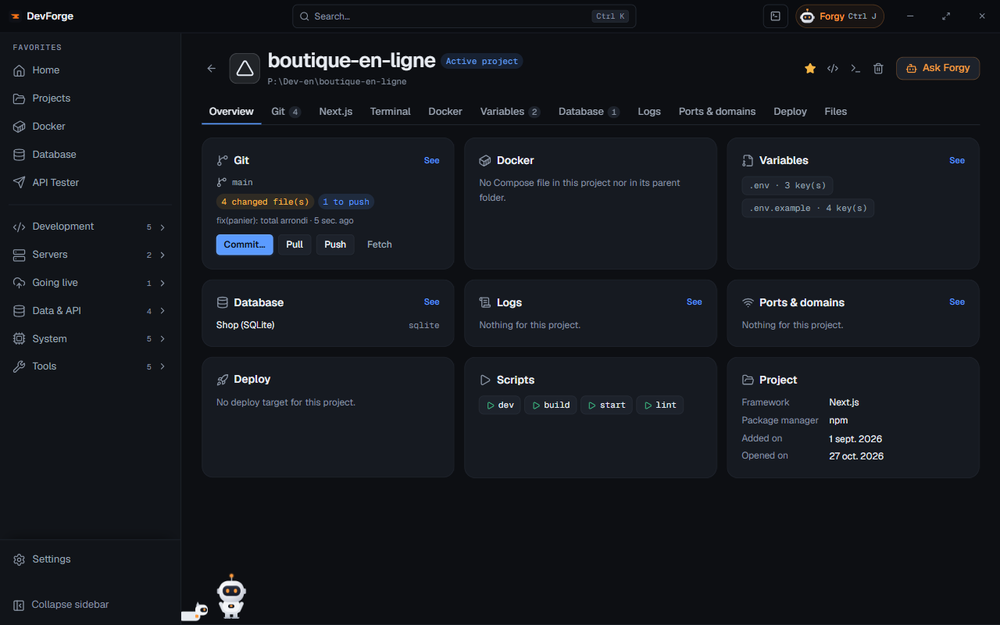
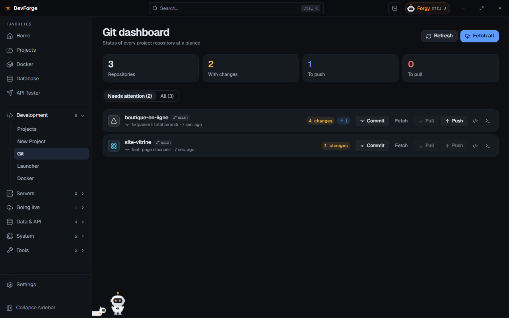

Forgy reads your changes, writes the message and suggests the commit. You read, you approve.

**You need**: a Git project with changes, and Forgy's Anthropic key ([Connections](/devforge/en/getting-started/connections/#forgy-anthropic)). About 5 minutes.

## 1. Open the project's page

The **Git** card shows the branch, the changed files and what is left to push.

## 2. Get a review, if you like

<kbd>Ctrl</kbd> <kbd>J</kbd> opens Forgy on this project. **Review changes** looks for bugs and risks in your diff before you commit.

## 3. Ask for the message

**Commit message**: Forgy reads the diff and writes a `type(scope): subject` message. Adjust it if needed, then write:

> Commit with this message.

## 4. Approve the card

Forgy shows a **Commit** card with the message and the files. **Nothing runs before your click**: **Approve** or **Refuse**.

## 5. Push, or go back

As long as the commit is not pushed, the **Action journal** (the panel's ☑ button) can undo it with **Undo this action**. When all is good, **Push** on the Git card, or from the **Git** page for all your projects at once.

## Going further

- [Forgy's actions](/devforge/en/forgy/actions/): what it can do, and Auto mode.
- [Git](/devforge/en/dev/git/): the dashboard of all your repositories.
- [Privacy and security](/devforge/en/privacy/#what-forgy-sends): what Forgy sends.
