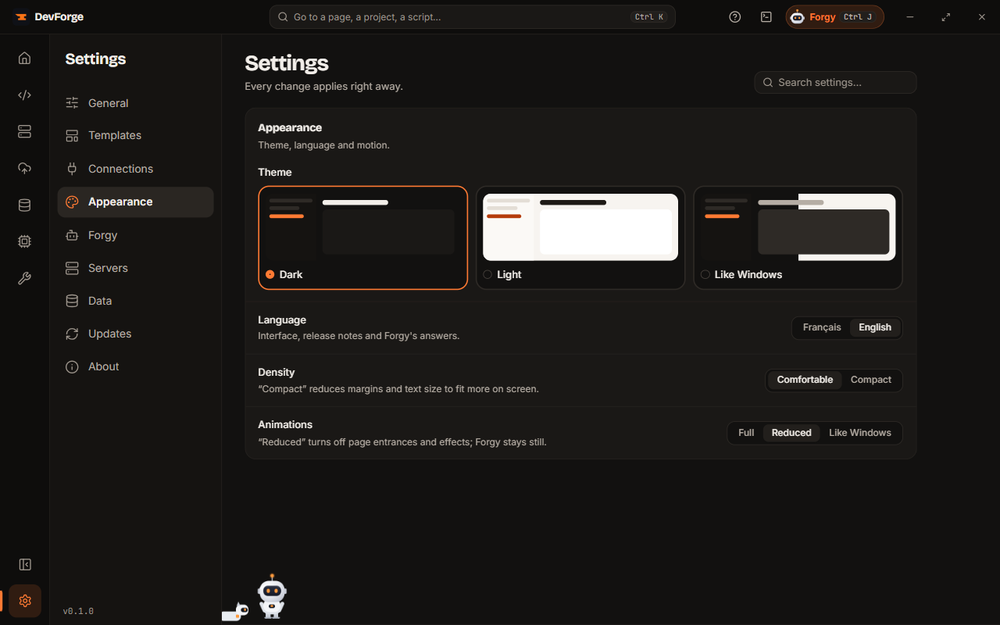

**Settings** is pinned at the bottom of the menu; its sections show in the menu's panel, or in a row above the settings when the window is narrow. Every change applies right away. **Search settings…** filters the sections (for example "theme", "budget", "backups").

| Section | Content |
|---|---|
| General | projects folders, package manager, IDE, terminal suggestions, startup, global launcher |
| [Templates](/devforge/en/dev/new-project/#my-templates) | your project templates: update, rename, delete |
| [Connections](/devforge/en/getting-started/connections/) | GitHub, Git identity, Vercel, Docker, Forgy key, servers, databases, n8n and alerts |
| Appearance | theme, language, animations, density |
| [Forgy](/devforge/en/forgy/assistant/#settings) | key, model, depth, budget, actions, desktop widget, dictation, stroll |
| Servers | background watching and alerts |
| [Data](/devforge/en/settings/data/) | folder, backups, log, export / import, erasing |
| Updates | installed version, channel, check, the version's changes |
| About | version, commit, build date, diagnostic report, GitHub, license |

## General

| Setting | Effect |
|---|---|
| Projects folders | the Projects page scans them all; the first gets new projects by default. Add, remove (nothing is deleted), reorder: see [Projects](/devforge/en/dev/projects/#several-projects-folders) |
| Default package manager | npm, pnpm or yarn, used when the project has no lock file |
| Default IDE | the IDE projects open in, among those found on this PC, or none; a project may have its own. See [IDE](/devforge/en/dev/ide/) |
| IDEs added by hand | a program and its arguments, with **Try**; see [IDE](/devforge/en/dev/ide/#adding-an-ide-by-hand) |
| Terminal suggestions | the line's likely rest, greyed; see [the terminal](/devforge/en/getting-started/interface/#suggestions) |
| Start with Windows | DevForge starts minimized when you sign in |
| Minimize to tray on close | closing the window keeps the watch and the widget running |
| Global launcher | turn it on, and change the shortcut (<kbd>Ctrl</kbd> <kbd>Alt</kbd> <kbd>Space</kbd> by default); see [Finding your way](/devforge/en/getting-started/interface/#the-global-launcher) |

## Appearance

| Setting | Choices |
|---|---|
| Theme | Dark, Light, or Like Windows |
| Language | French or English: interface, release notes and Forgy's answers |
| Animations | Full, Reduced (no page entrances or effects; Forgy stays still), or Like Windows |
| Density | Comfortable or Compact (smaller margins and text to fit more on screen) |

## Servers

One sample a minute in the background, kept 7 days. Two cards:

- **Watching**: a box per server in **Watched servers** (a coloured dot shows its last state), and the **Disk threshold**, a slider from 50 to 95 % (85 % by default). **See the curves** opens [Monitoring](/devforge/en/servers/monitoring/).
- **Warn me when**: a switch per alert, when a disk fills up, a container stops, a server stops answering or a site goes down.

Alerts arrive as Windows notifications, and Forgy sulks in the desktop widget.

## Updates

- The first card shows the **installed version**, its build date and commit, and "DevForge is up to date" when it is.
- **Channel**: *Stable* (final versions) or *Beta* (pre-releases too, earlier but sometimes with bugs).
- **Check** looks for a new version right away; otherwise it is automatic, 15 s after startup then every 6 h.
- A ready version installs on the next restart, or with **Restart and update**: a small window shows the installation's progress, then DevForge starts again by itself.
- **Show "What's new" after an update**: a window sums up the version on first launch; **See again** opens it again.
- **What's new in the version**: the installed version's changes, filtered by **All**, **New**, **Improvements** or **Fixes**. **See all versions →** opens the **release notes**: every version, in the app's language.

## About

The **This version** card gives the version and its channel, the commit, the build date and Electron's version. The **Help and license** card:

- **DevForge on GitHub**: **GitHub page** and **Report a problem**;
- **Release notes**: every version;
- **License**: DevForge is free software under GPL-3.0, **GPL-3.0 license** opens its text.

**Diagnostic report › Copy report** copies a **diagnostic report**: version, system and the last lines of the local log, keys and passwords masked. Nothing is sent: paste it wherever you want, for example in a [GitHub issue](https://github.com/victhille/devforge/issues). Read it first: it may contain server or project names.
