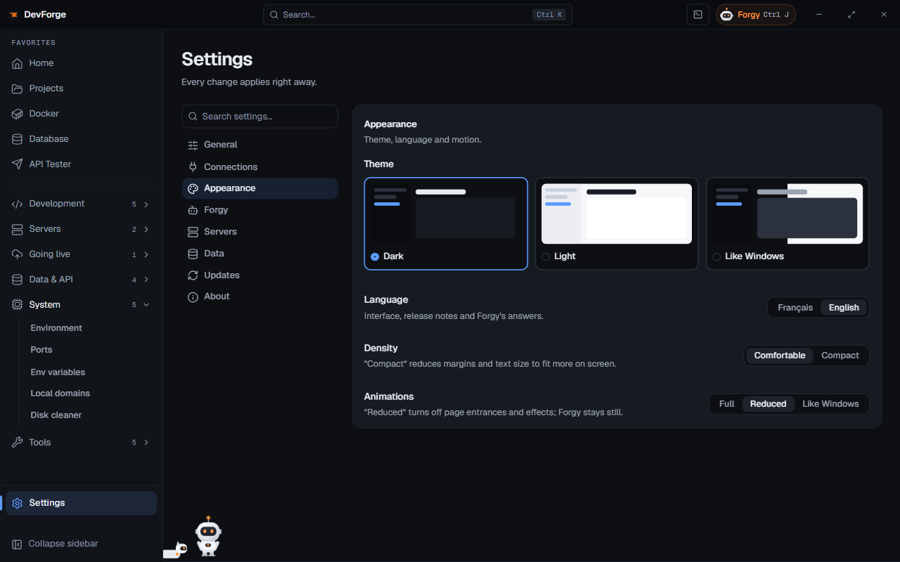

**Settings** is pinned at the bottom of the menu. Every change applies right away. **Search settings…** filters the sections (for example "theme", "budget", "backups").

| Section | Content |
|---|---|
| General | projects folder, package manager, IDE, startup, global launcher |
| [Connections](/devforge/en/getting-started/connections/) | GitHub, Git identity, Forgy key, Vercel, Docker, servers, databases |
| Appearance | theme, language, animations, density |
| [Forgy](/devforge/en/forgy/assistant/#settings) | key, model, depth, budget, actions, desktop widget, dictation, stroll |
| Servers | background watching and alerts |
| [Data](/devforge/en/settings/data/) | folder, backups, log, export / import, erasing |
| Updates | channel, check, release notes |
| About | version, commit, build date, diagnostic report |

## General

| Setting | Effect |
|---|---|
| Default projects directory | new projects are created here and the Projects page scans it |
| Default package manager | npm, pnpm or yarn, used when the project has no lock file |
| Default IDE | what the projects' "Open" button launches: VS Code (default), PhpStorm, WebStorm or none |
| Start with Windows | DevForge starts minimized when you sign in |
| Minimize to tray on close | closing the window keeps the watch and the widget running |
| Global launcher | turn it on, and change the shortcut (<kbd>Ctrl</kbd> <kbd>Alt</kbd> <kbd>Space</kbd> by default); see [Finding your way](/devforge/en/getting-started/interface/#the-global-launcher) |

## Appearance

| Setting | Choices |
|---|---|
| Theme | Dark, Light, or Like Windows |
| Language | French or English: interface, release notes and Forgy's answers |
| Animations | Full, Reduced (no page entrances or effects; Forgy stays still), or Like Windows |
| Density | Comfortable or Compact (smaller margins and text to fit more on screen) |

## Servers

One sample a minute in the background, kept 7 days:

- a **Watch in the background** switch per server;
- **Disk alert at** 75, 80, 85, 90 or 95 %;
- **Warn me when** a disk fills up, a container stops, a server stops answering, a site goes down.

Alerts arrive as Windows notifications. See [Monitoring](/devforge/en/servers/monitoring/).

## Updates

- **Channel**: *Stable* (final versions) or *Beta* (pre-releases too, earlier but sometimes with bugs).
- **Check** looks for a new version right away; otherwise it is automatic, 15 s after startup then every 6 h.
- A ready version installs on the next restart, or with **Restart and update**.
- **Show "What's new" after an update**: a window sums up the version on first launch.
- **Release notes**: every version, filterable (new, improvements, fixes), in the app's language.

## About

Version, commit and build date, links to the **GitHub page** and **Report a problem**.

**Copy report** copies a **diagnostic report**: version, system and the last lines of the local log, keys and passwords masked. Nothing is sent: paste it wherever you want, for example in a [GitHub issue](https://github.com/victhille/devforge/issues). Read it first: it may contain server or project names.
