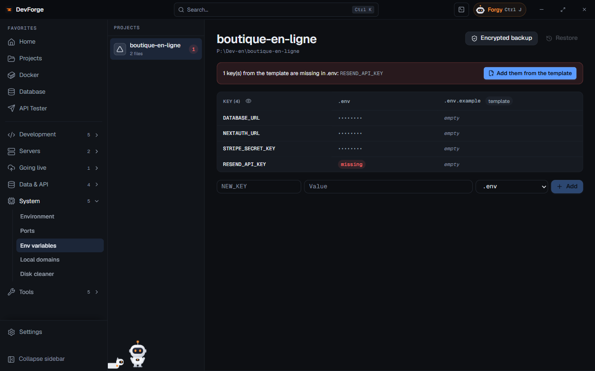

The **Env variables** page gathers the `.env` files of all your projects.

## Reading

On the left, the projects that have `.env`, `.env.local`, `.env.example`… files. On the right, a grid: one row per **key**, one column per file. A key can be *missing* or *empty* in a file; the example file is marked *template*.

Values are hidden by default: **Show values** / **Hide values**.

## Fill from the template

If keys of the template (`.env.example`) are missing in `.env`, a banner lists them. **Add them from the template** copies them into `.env`.

## Editing

**Edit** a value or **Add** a key writes straight to the file.

## Backing up

- **Encrypted backup** saves the project's `.env` files in DevForge, encrypted by Windows. The date of the last backup shows.
- **Restore** overwrites the `.env` files with the last backup, after confirmation.

A backup is also made before each [pull of a server's .env](/devforge/en/dev/projects/#sync-the-env-with-the-server).

:::note[Forgy and .env files]
Forgy never reads `.env` files (except example files). It can only propose to **add a new key**, value masked on the card, never to change an existing key.
:::
