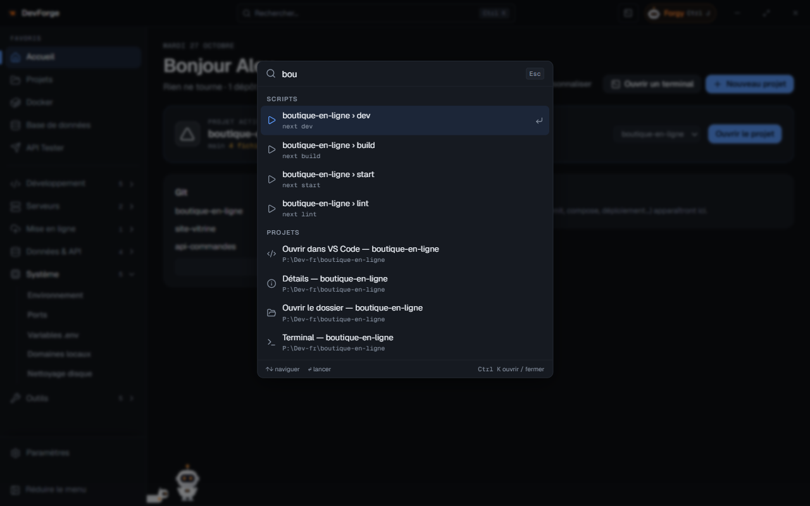

## L'accueil

L'accueil salue selon l'heure et résume ce qui tourne : conteneurs en ligne, ports en écoute, dépôts à pousser, état du serveur. Il est fait de **widgets** :

| Widget | Ce qu'il montre |
|---|---|
| Projet actif | le projet en cours, ses actions rapides (ouvrir, terminal, scripts) |
| Docker | les projets Compose et leurs services, avec Démarrer / Arrêter / Logs |
| VPS | la connexion SSH, la mémoire et le disque du serveur |
| Git | les dépôts modifiés ou à pousser, **Tout récupérer (fetch)** |
| Ports | les ports de dev en écoute |
| Activité | tes dernières actions (commit, Compose, déploiement, actions de Forgy…) |
| Santé du VPS, Services du VPS, Sauvegardes, n8n, VPN | un résumé de chaque page serveur |

**Personnaliser** permet de glisser les widgets (ou <kbd>Alt</kbd> + <kbd>↑</kbd> <kbd>↓</kbd> sur leur poignée), de les passer en pleine ou demi-largeur, d'en retirer ou d'en ajouter. **Par défaut** remet la disposition d'origine.

### Le projet actif

Un projet peut être **actif** : Forgy et le widget de bureau s'y rapportent. Il devient actif quand tu l'ouvres, ou se choisit dans le widget *Projet actif*.

## Le menu

Le menu de gauche commence par l'**Accueil** et tes **favoris**, puis range toutes les pages en six groupes repliables :

| Groupe | Pages |
|---|---|
| Développement | [Projets](/devforge/dev/projects/), [Nouveau projet](/devforge/dev/new-project/), [Git](/devforge/dev/git/), [Lanceur](/devforge/dev/stacks/), [Docker](/devforge/dev/docker/) |
| Serveurs | [SSH / VPS](/devforge/servers/ssh/), [Santé](/devforge/servers/health/), [Services](/devforge/servers/services/), [Sauvegardes](/devforge/servers/backups/), [Monitoring](/devforge/servers/monitoring/) |
| Mise en ligne | [Déploiement](/devforge/online/deploy/), [n8n](/devforge/online/n8n/), [VPN](/devforge/online/vpn/), [Page de statut](/devforge/online/status-page/) |
| Données & API | [Base de données](/devforge/data/database/), [API Tester](/devforge/data/api-tester/), [Webhooks](/devforge/data/webhooks/), [Logs](/devforge/data/logs/) |
| Système | [Environnement](/devforge/system/environment/), [Ports](/devforge/system/ports/), [Variables .env](/devforge/system/env-files/), [Domaines locaux](/devforge/system/domains/), [Nettoyage disque](/devforge/system/cleaner/) |
| Outils | [Boîte à outils, Snippets, Diff texte, Générateur, Docs](/devforge/tools/utilities/) |

**Paramètres** est épinglé en bas. <kbd>Ctrl</kbd> <kbd>B</kbd> réduit ou agrandit le menu.

Tant qu'aucun serveur n'est configuré, les pages qui en demandent un (Santé, Services, Sauvegardes, n8n, VPN, Page de statut) sont masquées ; le groupe indique « N de plus avec un serveur ».

### Favoris

Survole une page et clique sur ☆ pour l'épingler sous l'Accueil (10 favoris au plus). Glisse-les pour les réordonner (ou <kbd>Alt</kbd> + <kbd>↑</kbd> <kbd>↓</kbd>). Par défaut : Projets, Docker, Base de données et API Tester ; **Remettre les favoris par défaut** y revient.

## La palette de commandes

<kbd>Ctrl</kbd> <kbd>K</kbd> ouvre une recherche sur tout DevForge : **pages**, **projets** (ouvrir dans VS Code, détails, dossier, terminal), **scripts** de tes projets, **stacks** à démarrer, **serveurs** (tableau de bord), et des **actions** :

- ouvrir ou redémarrer n8n, ouvrir wg-easy, créer un client VPN ;
- sauvegarder le serveur maintenant, copier la dernière sauvegarde sur ce PC, voir la santé du serveur ;
- ouvrir un service web du serveur ;
- récupérer tous les dépôts Git (fetch) ;
- passer en thème clair ou sombre, activer ou couper le mode compact ;
- chercher une mise à jour de DevForge.

<kbd>↑</kbd> <kbd>↓</kbd> pour naviguer, <kbd>Entrée</kbd> pour lancer. Une action sensible (redémarrer n8n, sauvegarder) demande confirmation.

## Le lanceur global

Le **lanceur global** est une barre de recherche par-dessus n'importe quelle application, même quand DevForge est réduit dans la zone de notification. Raccourci par défaut : <kbd>Ctrl</kbd> <kbd>Alt</kbd> <kbd>Espace</kbd>.

Tape un projet, une page ou une action ; ce que tu lances souvent remonte en premier. Il comprend aussi :

- un **calcul** (`12*7`), un **timestamp**, une **date**, du **Base64**, une **couleur** : le résultat se copie ;
- une question : **Demander à Forgy « … »**.

Une action sensible demande <kbd>Entrée</kbd> une seconde fois. Le lanceur se règle dans **Paramètres › Général** : activer, changer de raccourci (avec <kbd>Ctrl</kbd>, <kbd>Alt</kbd> ou <kbd>Win</kbd>). Pour qu'il soit toujours prêt, DevForge propose de démarrer avec Windows, réduit.

## Le terminal intégré

<kbd>Ctrl</kbd> <kbd>`</kbd> ouvre le terminal en bas de la fenêtre, avec des onglets (**+** pour en ouvrir un). Chaque commande devient un **bloc** : sa sortie, son code de retour et sa durée.

- Sur un bloc : **Copier la sortie**, **Relancer**, **Enregistrer comme snippet**, **Expliquer avec Forgy** (proposé quand la commande échoue).
- <kbd>↑</kbd> <kbd>↓</kbd> parcourent l'historique du dossier, <kbd>Ctrl</kbd> <kbd>R</kbd> y cherche.
- Une ligne qui commence par `#` est une question pour Forgy.
- Pendant qu'un programme tourne, tape dans le bloc, ou **Arrêter** (<kbd>Ctrl</kbd> <kbd>C</kbd>).

## Raccourcis

| Raccourci | Effet |
|---|---|
| <kbd>Ctrl</kbd> <kbd>K</kbd> | palette de commandes |
| <kbd>Ctrl</kbd> <kbd>J</kbd> | ouvrir / fermer Forgy |
| <kbd>Ctrl</kbd> <kbd>B</kbd> | réduire / agrandir le menu |
| <kbd>Ctrl</kbd> <kbd>`</kbd> | terminal intégré |
| <kbd>Ctrl</kbd> <kbd>Entrée</kbd> | exécuter la requête SQL |
| <kbd>Ctrl</kbd> <kbd>Alt</kbd> <kbd>Espace</kbd> | lanceur global (de n'importe où) |
| <kbd>Ctrl</kbd> <kbd>Alt</kbd> <kbd>J</kbd> | Forgy sur le bureau, quand le lanceur a pris <kbd>Ctrl</kbd> <kbd>Alt</kbd> <kbd>Espace</kbd> |
