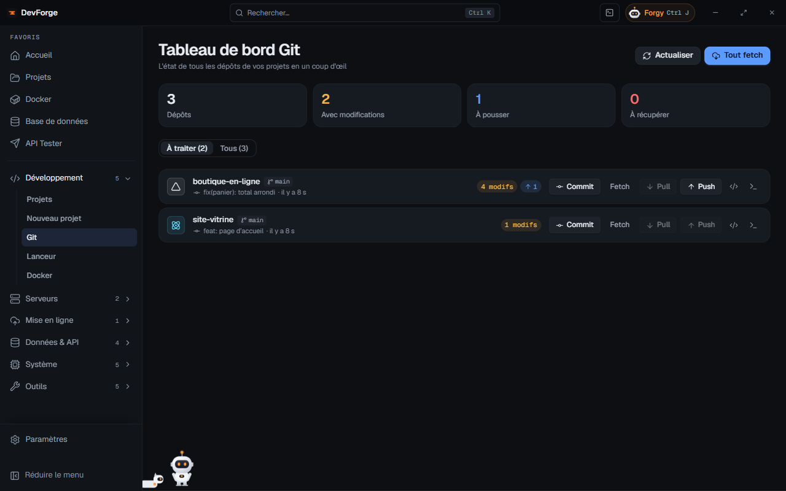

Forgy lit tes changements, écrit le message et propose le commit. Tu relis, tu valides.

**Il faut** : un projet Git avec des changements, et la clé Anthropic de Forgy ([Connexions](/devforge/getting-started/connections/#forgy-anthropic)). Compter 5 minutes.

## 1. Ouvre la fiche du projet

La carte **Git** montre la branche, les fichiers modifiés et ce qui reste à pousser.

## 2. Fais relire, si tu veux

<kbd>Ctrl</kbd> <kbd>J</kbd> ouvre Forgy sur ce projet. **Revue des changements** cherche les bugs et les risques dans ton diff avant de commiter.

## 3. Demande le message

**Message de commit** : Forgy lit le diff et rédige un message au format `type(zone): sujet`. Ajuste-le si besoin, puis écris :

> Fais le commit avec ce message.

## 4. Valide la carte

Forgy propose une carte **Commit** avec le message et les fichiers. **Rien ne s'exécute avant ton clic** : **Valider** ou **Refuser**.

## 5. Pousse, ou reviens en arrière

Tant que le commit n'est pas poussé, le **Journal des actions** (bouton ☑ du panneau) peut l'annuler avec **Annuler cette action**. Quand tout est bon, **Push** sur la carte Git, ou depuis la page **Git** pour tous tes projets d'un coup.

## Pour aller plus loin

- [Les actions de Forgy](/devforge/forgy/actions/) : ce qu'il peut faire, et le mode Auto.
- [Git](/devforge/dev/git/) : le tableau de bord de tous tes dépôts.
- [Vie privée et sécurité](/devforge/privacy/#ce-que-forgy-envoie) : ce que Forgy envoie.
