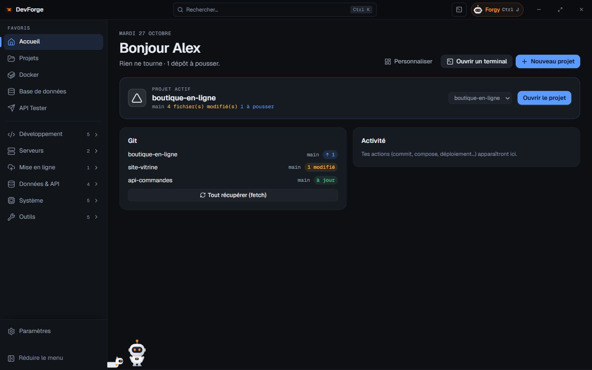

import { Card, CardGrid, LinkCard } from '@astrojs/starlight/components'
import Download from '../../components/Download.astro'

<Download lang="fr" />

## Tout au même endroit

<CardGrid>
  <Card title="Projets" icon="open-book">
    Tes projets repérés dans ton dossier, une fiche par projet : Git, scripts, variables, ports, base, logs, terminal. Création guidée pour React, Next.js, Vue, Node.js, Symfony et Laravel.
  </Card>
  <Card title="Git et GitHub" icon="github">
    L'état de tous tes dépôts d'un coup d'œil, commit, pull et push, GitHub Actions, pull requests et releases.
  </Card>
  <Card title="Docker" icon="seti:docker">
    Conteneurs, images et projets Compose, en local et sur ton serveur, avec les logs en direct.
  </Card>
  <Card title="Serveurs" icon="laptop">
    Terminal SSH, tableau de bord, santé et sécurité, sauvegardes de nuit, n8n, VPN WireGuard et page de statut publique.
  </Card>
  <Card title="Données et API" icon="list-format">
    Client PostgreSQL, MySQL / MariaDB et SQLite, testeur d'API, capture de webhooks et lecteur de logs.
  </Card>
  <Card title="Forgy" icon="star">
    Un assistant IA avec ta propre clé Anthropic. Il lit tes projets, explique, et propose des actions que tu valides une par une.
  </Card>
</CardGrid>

## Rien de configuré d'avance

DevForge ne contient aucun compte ni aucun serveur. Au premier lancement, tu choisis ta langue et ton dossier de projets, puis tu branches seulement ce dont tu te sers : GitHub, un serveur, Vercel, des bases, la clé de Forgy. Tout reste sur ton PC ; clés, jetons et mots de passe sont chiffrés par Windows.

<CardGrid>
  <LinkCard title="Installer DevForge" description="L'installeur, l'alerte SmartScreen et les mises à jour automatiques." href="/devforge/getting-started/installation/" />
  <LinkCard title="Premier lancement" description="Les cinq étapes de l'accueil, toutes facultatives." href="/devforge/getting-started/first-launch/" />
  <LinkCard title="Brancher ses comptes" description="Paramètres › Connexions : GitHub, Git, Forgy, Vercel, Docker, serveurs, bases." href="/devforge/getting-started/connections/" />
  <LinkCard title="Rencontrer Forgy" description="Ce que l'assistant lit, ce qu'il peut faire et combien il coûte." href="/devforge/forgy/assistant/" />
</CardGrid>

## Libre et ouvert

DevForge est publié sous licence MIT. Le code, les versions et les demandes d'amélioration sont sur [GitHub](https://github.com/victhille/devforge). Le site n'utilise ni cookie ni mesure d'audience.
