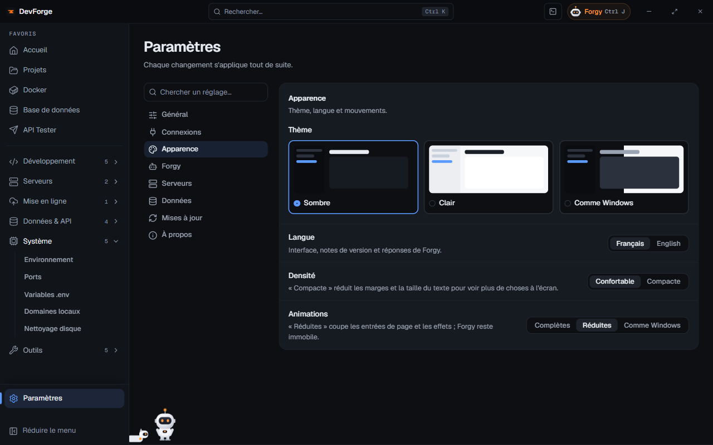

**Paramètres** est épinglé en bas du menu. Chaque changement s'applique tout de suite. **Chercher un réglage…** filtre les sections (par exemple « thème », « budget », « sauvegardes »).

| Section | Contenu |
|---|---|
| Général | dossier de projets, gestionnaire de paquets, IDE, démarrage, lanceur global |
| [Connexions](/devforge/getting-started/connections/) | GitHub, identité Git, clé Forgy, Vercel, Docker, serveurs, bases |
| Apparence | thème, langue, animations, densité |
| [Forgy](/devforge/forgy/assistant/#réglages) | clé, modèle, profondeur, budget, actions, widget de bureau, dictée, balade |
| Serveurs | surveillance en arrière-plan et alertes |
| [Données](/devforge/settings/data/) | dossier, sauvegardes, journal, export / import, effacement |
| Mises à jour | canal, vérification, notes de version |
| À propos | version, commit, date de build, rapport de diagnostic |

## Général

| Réglage | Effet |
|---|---|
| Dossier de projets par défaut | les nouveaux projets sont créés ici et la page Projets le parcourt |
| Gestionnaire de paquets par défaut | npm, pnpm ou yarn, utilisé quand le projet n'a pas de fichier de verrou |
| IDE par défaut | ce que lance le bouton « Ouvrir » des projets : VS Code (par défaut), PhpStorm, WebStorm ou aucun |
| Démarrer avec Windows | DevForge s'ouvre réduit à l'ouverture de session |
| Réduire dans la barre système à la fermeture | fermer la fenêtre garde la surveillance et le widget actifs |
| Lanceur global | activer, et changer le raccourci (<kbd>Ctrl</kbd> <kbd>Alt</kbd> <kbd>Espace</kbd> par défaut) ; voir [Se repérer](/devforge/getting-started/interface/#le-lanceur-global) |

## Apparence

| Réglage | Choix |
|---|---|
| Thème | Sombre, Clair, ou Comme Windows |
| Langue | Français ou Anglais : interface, notes de version et réponses de Forgy |
| Animations | Complètes, Réduites (pas d'entrée de page ni d'effets ; Forgy reste immobile), ou Comme Windows |
| Densité | Confortable ou Compacte (marges et texte réduits pour voir plus de choses) |

## Serveurs

Un relevé par minute en arrière-plan, gardé 7 jours :

- un interrupteur **Surveiller en arrière-plan** par serveur ;
- **Alerte disque à** 75, 80, 85, 90 ou 95 % ;
- **Me prévenir quand** le disque se remplit, un conteneur s'arrête, un serveur ne répond plus, un site tombe.

Les alertes arrivent en notification Windows. Voir [Monitoring](/devforge/servers/monitoring/).

## Mises à jour

- **Canal** : *Stable* (versions finales) ou *Bêta* (aussi les préversions, plus tôt mais parfois avec des bugs).
- **Vérifier** cherche tout de suite une nouvelle version ; sinon c'est automatique, 15 s après le démarrage puis toutes les 6 h.
- Une version prête s'installe au prochain redémarrage, ou avec **Redémarrer et mettre à jour**.
- **Montrer « Quoi de neuf » après une mise à jour** : une fenêtre résume la version au premier lancement.
- **Notes de version** : toutes les versions, filtrables (nouveautés, améliorations, corrections), dans la langue de l'application.

## À propos

Version, commit et date de build, liens vers la **page GitHub** et **Signaler un problème**.

**Copier le rapport** copie un **rapport de diagnostic** : version, système et dernières lignes du journal local, clés et mots de passe masqués. Rien n'est envoyé : colle-le où tu veux, par exemple dans une [issue GitHub](https://github.com/victhille/devforge/issues). Relis-le avant : il peut contenir des noms de serveurs ou de projets.
