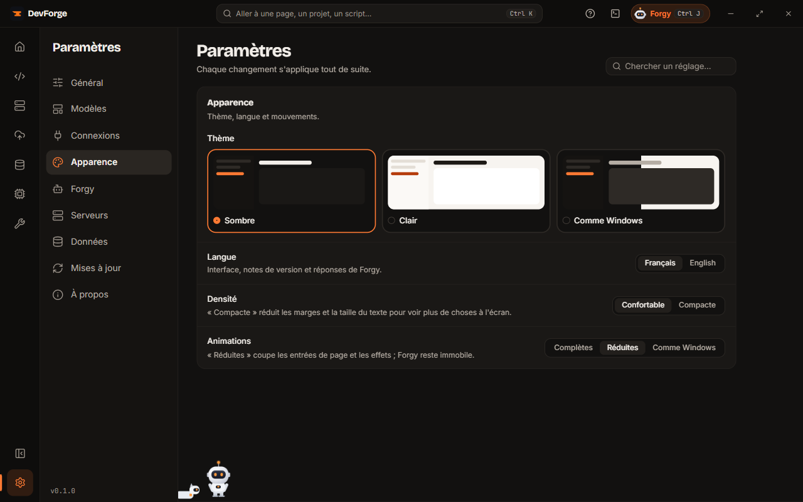

**Paramètres** est épinglé en bas du menu ; ses sections s'affichent dans le panneau du menu, ou en rangée au-dessus des réglages quand la fenêtre est étroite. Chaque changement s'applique tout de suite. **Chercher un réglage…** filtre les sections (par exemple « thème », « budget », « sauvegardes »).

| Section | Contenu |
|---|---|
| Général | dossiers de projets, gestionnaire de paquets, IDE, suggestions du terminal, démarrage, lanceur global |
| [Modèles](/devforge/dev/new-project/#mes-modèles) | tes modèles de projet : mettre à jour, renommer, supprimer |
| [Connexions](/devforge/getting-started/connections/) | GitHub, identité Git, Vercel, Docker, clé Forgy, serveurs, bases, n8n et alertes |
| Apparence | thème, langue, couleur principale, taille du texte, densité, animations, aperçu |
| [Forgy](/devforge/forgy/assistant/#réglages) | clé, modèle, profondeur, budget, actions, widget de bureau, dictée, balade |
| Serveurs | surveillance en arrière-plan et alertes |
| [Données](/devforge/settings/data/) | dossier, sauvegardes, journal, export / import, effacement |
| Mises à jour | version installée, canal, vérification, nouveautés de la version |
| À propos | version, commit, date de build, rapport de diagnostic, GitHub, licence |

## Général

| Réglage | Effet |
|---|---|
| Dossiers de projets | la page Projets les parcourt tous ; le premier (l'étoile, *par défaut*) reçoit les nouveaux projets. **Ajouter un dossier**, × pour en retirer un (rien n'est supprimé), l'icône d'un autre dossier devient une étoile pour le mettre par défaut : voir [Projets](/devforge/dev/projects/#plusieurs-dossiers-de-projets) |
| Gestionnaire de paquets par défaut | npm, pnpm ou yarn, utilisé quand le projet n'a pas de fichier de verrou |
| IDE par défaut | l'IDE qui ouvre les projets, parmi ceux trouvés sur ce PC, ou aucun ; un projet peut avoir le sien. Voir [IDE](/devforge/dev/ide/) |
| Ajouter un IDE | à côté de la liste : un programme et ses arguments, avec **Essayer** ; les IDE ajoutés s'affichent dessous. Voir [IDE](/devforge/dev/ide/#ajouter-un-ide-à-la-main) |
| Suggestions dans le terminal | la suite probable de la ligne en gris ; voir [le terminal](/devforge/getting-started/interface/#les-suggestions) |
| Démarrer avec Windows | DevForge s'ouvre réduit à l'ouverture de session |
| Réduire dans la barre système à la fermeture | fermer la fenêtre garde la surveillance et le widget actifs |
| Lanceur global | dans **Démarrage et fenêtre** : son raccourci touche par touche (<kbd>Ctrl</kbd> <kbd>Alt</kbd> <kbd>Espace</kbd> par défaut), **Changer** puis la nouvelle combinaison, et un interrupteur pour le couper ; voir [Se repérer](/devforge/getting-started/interface/#le-lanceur-global) |

## Apparence

| Réglage | Choix |
|---|---|
| Thème | Sombre, Clair, ou Comme Windows |
| Langue | Français ou Anglais : interface, notes de version et réponses de Forgy |
| Animations | Complètes, Réduites (pas d'entrée de page ni d'effets ; Forgy reste immobile), ou Comme Windows |
| Couleur principale | Orange Forge, Bleu, Violet, Rose, Turquoise ou Vert : toute l'apparence en prend la teinte (fonds, cartes, menus, bordures, textes, boutons, liens et Forgy), en thème sombre comme clair ; seul le logo reste orange. Chaque texte garde un contraste d'au moins 4,5:1 |
| Taille du texte | Petite, Normale, Grande ou Très grande : le texte de toute l'application, la mise en page ne bouge pas |
| Densité | Confortable ou Compacte (marges et texte réduits pour voir plus de choses) |

À côté, la carte **Aperçu** montre une carte de projet avec ces choix, avant d'aller voir les pages.

## Serveurs

Un relevé par minute en arrière-plan, gardé 7 jours. Deux cartes :

- **Surveillance** : une case par serveur dans **Serveurs surveillés**, et le **Seuil du disque**, un curseur de 50 à 95 % (85 % par défaut). **Voir les courbes** ouvre [Monitoring](/devforge/servers/monitoring/).
- **Me prévenir quand** : un interrupteur par alerte, quand le disque se remplit, un conteneur s'arrête, un serveur ne répond plus ou un site tombe.

Les alertes arrivent en notification Windows, et Forgy fait la tête dans le widget de bureau (le lien **widget** mène à son réglage, dans Forgy › Présence).

## Mises à jour

- La première carte montre la **version installée**, sa date de construction et son commit, et « DevForge est à jour » quand c'est le cas.
- **Canal** : *Stable* (versions finales) ou *Bêta* (aussi les préversions, plus tôt mais parfois avec des bugs).
- **Vérifier** cherche tout de suite une nouvelle version ; sinon c'est automatique, 15 s après le démarrage puis toutes les 6 h.
- Une version prête s'installe au prochain redémarrage, ou avec **Redémarrer et mettre à jour** : une petite fenêtre montre l'avancement de l'installation, puis DevForge se relance tout seul.
- **Montrer « Quoi de neuf » après une mise à jour** : une fenêtre résume la version au premier lancement ; **Revoir** la rouvre.
- **Nouveautés de la version** : les changements de la version installée, filtrés par **Tout**, **Nouveautés**, **Améliorations** ou **Corrections**. **Voir toutes les versions →** ouvre les **notes de version** : toutes les versions, dans la langue de l'application.

## À propos

La carte **Cette version** donne la version et son canal, le commit, la date de build et la version d'Electron. La carte **Aide et licence** :

- **DevForge sur GitHub** : **Page GitHub** et **Signaler un problème** ;
- **Notes de version** : toutes les versions ;
- **Licence** : DevForge est un logiciel libre sous GPL-3.0, **Licence GPL-3.0** en ouvre le texte.

**Rapport de diagnostic › Copier le rapport** copie un **rapport de diagnostic** : version, système et dernières lignes du journal local, clés et mots de passe masqués. Rien n'est envoyé : colle-le où tu veux, par exemple dans une [issue GitHub](https://github.com/victhille/devforge/issues). Relis-le avant : il peut contenir des noms de serveurs ou de projets.
