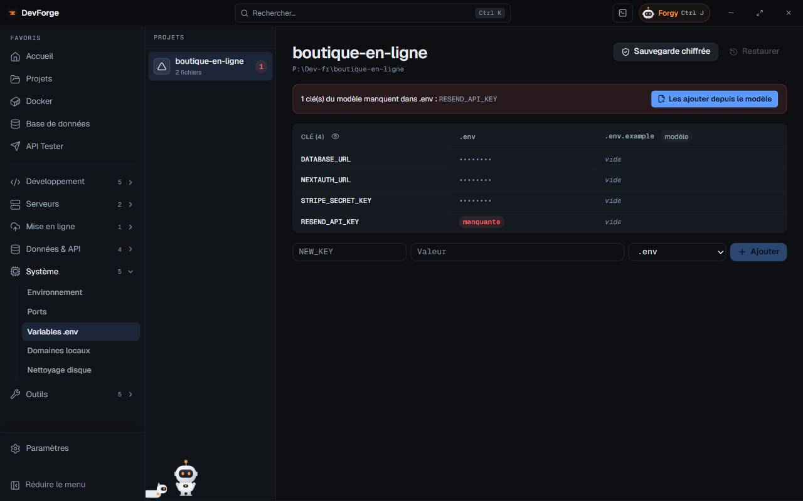

La page **Variables .env** réunit les fichiers `.env` de tous tes projets.

## Lire

À gauche, les projets qui ont des fichiers `.env`, `.env.local`, `.env.example`… À droite, une grille : une ligne par **clé**, une colonne par fichier. Une clé peut être *manquante* ou *vide* dans un fichier ; le fichier d'exemple est marqué *modèle*.

Les valeurs sont masquées par défaut : **Afficher les valeurs** / **Masquer les valeurs**.

## Compléter depuis le modèle

Si des clés du modèle (`.env.example`) manquent dans `.env`, un bandeau les liste. **Les ajouter depuis le modèle** les copie dans `.env`.

## Modifier

**Modifier** une valeur ou **Ajouter** une clé écrit directement dans le fichier.

## Sauvegarder

- **Sauvegarde chiffrée** enregistre les `.env` du projet dans DevForge, chiffrés par Windows. La date de la dernière sauvegarde s'affiche.
- **Restaurer** écrase les fichiers `.env` avec la dernière sauvegarde, après confirmation.

Une sauvegarde est aussi faite avant chaque [récupération du .env d'un serveur](/devforge/dev/projects/#synchroniser-le-env-avec-le-serveur).

:::note[Forgy et les .env]
Forgy ne lit jamais les fichiers `.env` (sauf les fichiers d'exemple). Il peut seulement proposer d'**ajouter une nouvelle clé**, valeur masquée sur la carte, jamais de modifier une clé existante.
:::
