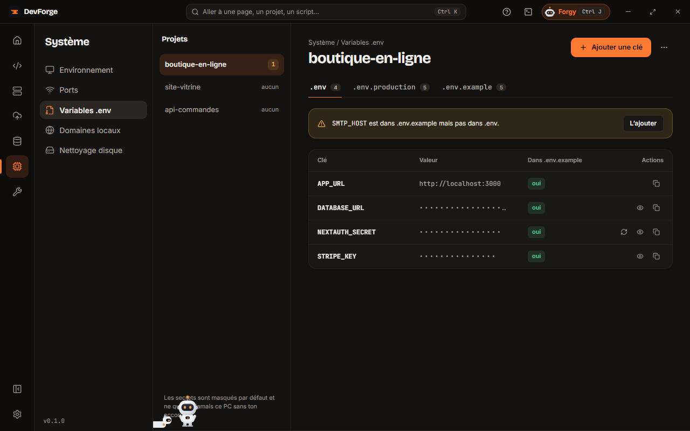

La page **Variables .env** réunit les fichiers `.env` de tous tes projets.

## Lire

À gauche, tous tes projets : ceux qui ont des fichiers `.env`, `.env.local`, `.env.example`… en premier, avec le nombre de clés qui manquent à leur `.env` ou leur nombre de fichiers. À droite, un onglet par fichier, avec son nombre de clés, et un tableau : la **clé**, sa **valeur**, si le fichier d'exemple l'a (*oui* / *non*) et les actions.

Les secrets sont masqués par défaut : seules les clés de réglage connues (`NODE_ENV`, `APP_URL`, `…_HOST`, `…_PORT`, `NEXT_PUBLIC_…`, `VITE_…`) s'affichent en clair, jamais une adresse qui contient un mot de passe. L'œil d'une ligne montre sa valeur ; l'icône de copie la copie.

## Compléter depuis le modèle

Si des clés du modèle (`.env.example`) manquent dans `.env`, un bandeau le dit (« STRIPE_KEY est dans .env.example mais pas dans .env. »). **L'ajouter** ou **Les ajouter** les copie dans `.env`.

## Modifier

Le crayon d'une ligne (ou un double-clic sur sa valeur) la modifie ; la corbeille la supprime. **Ajouter une clé** ouvre une ligne en haut du tableau : la clé et sa valeur vont dans le fichier de l'onglet ouvert. Tout s'écrit directement dans le fichier.

L'icône **Régénérer** (deux flèches) apparaît à côté des secrets que l'application tire elle-même, reconnus à leur nom exact : `APP_KEY`, `APP_SECRET`, `SECRET_KEY`, `SESSION_SECRET`, `JWT_SECRET`, `AUTH_SECRET`, `NEXTAUTH_SECRET`, `BETTER_AUTH_SECRET`, `COOKIE_SECRET`, `CSRF_SECRET`. Après confirmation, DevForge fait une **sauvegarde chiffrée** des fichiers `.env`, puis écrit un nouveau secret tiré au hasard : 32 octets en hexadécimal, ou `base64:` suivi de 32 octets pour l'`APP_KEY` de Laravel. Les sessions ouvertes et ce qui a été chiffré avec l'ancienne valeur ne sont plus lisibles ; **Restaurer** reprend la sauvegarde. Les secrets donnés par un service (`STRIPE_KEY`, `GITHUB_CLIENT_SECRET`, un token d'API) et les clés de chiffrement ne sont jamais proposés.

## Sauvegarder

- **Sauvegarde chiffrée** (dans le menu **⋯**) enregistre les `.env` du projet dans DevForge, chiffrés par Windows. La date de la dernière sauvegarde s'affiche à droite des onglets.
- **Restaurer** (dans le menu **⋯**, une fois une sauvegarde faite) écrase les fichiers `.env` avec la dernière sauvegarde, après confirmation.

Une sauvegarde est aussi faite avant chaque [récupération du .env d'un serveur](/devforge/dev/projects/#synchroniser-le-env-avec-le-serveur).

:::note[Forgy et les .env]
Forgy ne lit jamais les fichiers `.env` (sauf les fichiers d'exemple). Il peut seulement proposer d'**ajouter une nouvelle clé**, valeur masquée sur la carte, jamais de modifier une clé existante.
:::
